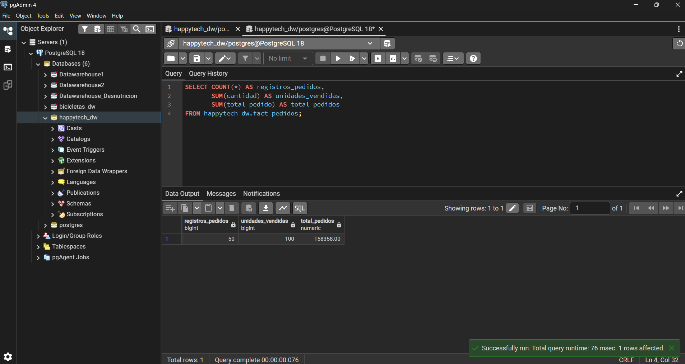
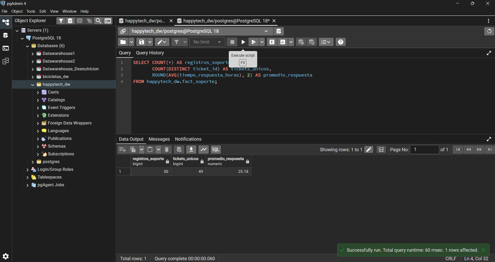
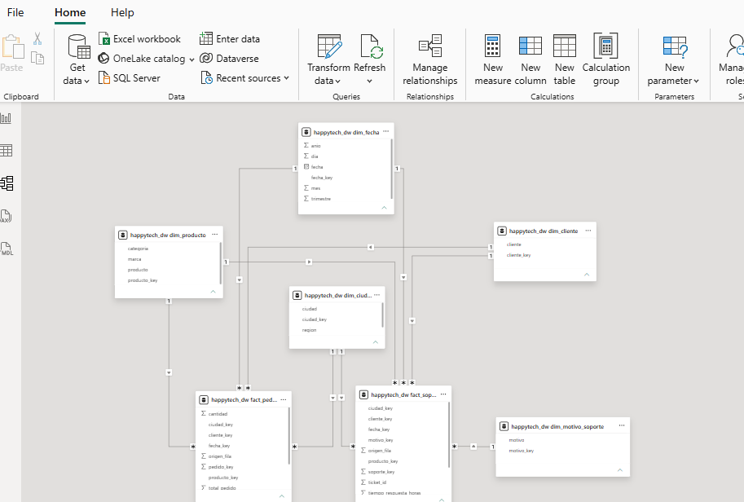
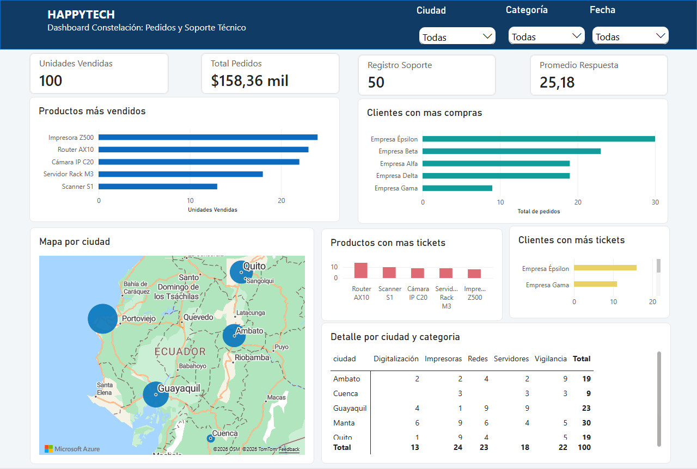
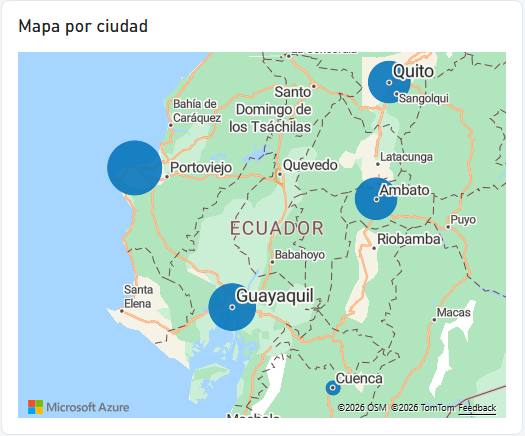
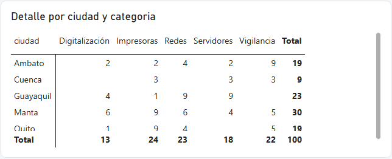

# ESCUELA POLITÉCNICA NACIONAL

### Facultad de Ingeniería de Sistemas

**Asignatura:** Business Intelligence  
**Paralelo:** GR2SW  
**Integrantes:** Chanatasig Garzón Juan Francisco; Chimarro Bermeo Marlon Xavier; Dávalos Cedeño Martín Alejandro; De La Cruz Cañar Kevin Santiago.  
**Fecha:** martes 17 de noviembre de 2026  

---

**Trabajo grupal:** Caso de estudio CONSTELACIÓN

Este informe documenta el desarrollo de un modelo dimensional de tipo constelación para la empresa tecnológica HAPPYTECH. Se utilizaron dos conjuntos de datos, correspondientes a pedidos y solicitudes de soporte técnico, con el fin de implementar dos tablas de hechos vinculadas a dimensiones conformadas, según el enunciado de la actividad [2]. El proceso comprendió el análisis de la fuente, el diseño lógico, la creación y carga de estructuras en PostgreSQL, la incorporación del modelo en Power BI y la elaboración de un informe interactivo con indicadores, gráficos comparativos, una matriz por ciudad y categoría y un mapa geográfico. Se explican los resultados obtenidos, las validaciones realizadas y las evidencias necesarias para presentar la actividad, de acuerdo con los conceptos de la clase sobre esquemas constelación, granularidad y Bus Matrix [1].

## Índice

- [1. Objetivo y alcance](#1-objetivo-y-alcance)
- [2. Entorno de trabajo y fuentes de datos](#2-entorno-de-trabajo-y-fuentes-de-datos)
- [3. Análisis y diseño del esquema constelación](#3-análisis-y-diseño-del-esquema-constelación)
- [4. Implementación del modelo en PostgreSQL](#4-implementación-del-modelo-en-postgresql)
- [5. Importación y modelado en Power BI](#5-importación-y-modelado-en-power-bi)
- [6. Construcción del dashboard](#6-construcción-del-dashboard)
- [7. Análisis de resultados](#7-análisis-de-resultados)
- [8. Validaciones y consideraciones técnicas](#8-validaciones-y-consideraciones-técnicas)
- [9. Conclusiones](#9-conclusiones)
- [10. Referencias bibliográficas](#10-referencias-bibliográficas)
- [11. Entregables](#11-entregables)
- [12. Declaración del uso de inteligencia artificial](#12-declaración-del-uso-de-inteligencia-artificial)

---

## 1. Objetivo y alcance

### 1.1. Objetivo general

Diseñar e implementar un esquema dimensional de tipo **constelación** que integre los procesos de pedidos y soporte técnico de HAPPYTECH, utilizando PostgreSQL para el almacenamiento de datos y Power BI para representar y analizar los resultados mediante visualizaciones interactivas.

### 1.2. Objetivos específicos

1. Analizar la estructura y el contenido de las hojas de pedidos y soporte técnico entregadas para el caso de estudio.
2. Identificar las tablas de hechos, las dimensiones conformadas, las dimensiones específicas y la granularidad de cada proceso.
3. Elaborar el modelo constelación a mano, con sus claves y relaciones, y definir la correspondiente **Bus Matrix**.
4. Implementar en PostgreSQL las estructuras físicas y la carga de información, utilizando tablas intermedias (*staging*) y consultas de validación.
5. Importar las tablas dimensionales a Power BI y representar sus relaciones en la Vista Modelo.
6. Construir un informe que responda las cuatro preguntas de negocio: ventas por producto/categoría y ciudad; clientes que más compran por ciudad; productos/categorías con más soporte; y clientes con más soporte.

### 1.3. Alcance

El trabajo se concentra en los registros contenidos en el archivo `Caso_Constelacion_Pedidos_Soporte.xlsx`, correspondientes a enero de 2025. Se desarrolla un modelo analítico local y un informe en Power BI Desktop. El informe fue publicado en Power BI Service y su enlace público se incluye en la sección de entregables (apartado 11).

## 2. Entorno de trabajo y fuentes de datos

### 2.1. Herramientas utilizadas

**Tabla 1. Herramientas utilizadas en la práctica.**

| Herramienta | Función en la práctica |
|---|---|
| Microsoft Excel | Fuente de datos para pedidos y soporte técnico. |
| PostgreSQL | Sistema gestor de base de datos utilizado para almacenar el modelo dimensional. |
| pgAdmin 4 | Interfaz para ejecutar el script SQL y las consultas de comprobación. |
| Power BI Desktop | Importación, modelado semántico, medidas DAX y construcción del informe visual. |
| Azure Maps para Power BI | Visualización geográfica de unidades vendidas por ciudad. |

### 2.2. Datos de origen

El archivo Excel contiene dos hojas, descritas en la Tabla 2:

**Tabla 2. Hojas del archivo de origen.**

| Hoja | Registros | Variables principales |
|---|---:|---|
| `hechos_pedidos` | 50 | Fecha, producto, categoría, marca, cliente, ciudad, región, cantidad y total del pedido. |
| `hechos_soporte` | 50 | Fecha, producto, categoría, marca, cliente, ciudad, región, identificador de ticket, motivo y tiempo de respuesta. |

Ambos procesos comparten datos descriptivos de productos, clientes, fechas y localizaciones. Por esta razón se establecieron dimensiones reutilizables, en lugar de construir modelos independientes. El conjunto presenta cinco productos, cinco clientes y cinco ciudades: Quito, Guayaquil, Cuenca, Ambato y Manta.

## 3. Análisis y diseño del esquema constelación

### 3.1. Justificación del esquema

De acuerdo con el contenido de la Clase 4, un **esquema constelación** representa varios procesos dentro de un mismo modelo dimensional, con múltiples tablas de hechos y dimensiones compartidas o específicas [1], [5]. HAPPYTECH registra ventas y atenciones de soporte técnico; por lo tanto, el uso de dos tablas de hechos permite conservar las medidas propias de cada actividad y compararlas mediante dimensiones conformadas.

La propuesta también sigue el principio de **no relacionar directamente dos tablas de hechos**. En su lugar, las comparaciones se realizan por medio de las dimensiones compartidas, tal como se explica en los apuntes de clase [1].

### 3.2. Identificación de tablas de hechos

**Tabla 3. Tablas de hechos del modelo.**

| Tabla | Proceso | Granularidad | Medidas o campos analíticos |
|---|---|---|---|
| `fact_pedidos` | Comercialización | Una fila por registro de producto vendido a un cliente en una fecha y ciudad. | `cantidad`, `total_pedido`. |
| `fact_soporte` | Soporte técnico | Una fila por registro de soporte asociado a producto, cliente, fecha y ciudad. | `tiempo_respuesta_horas`; recuento de filas y `ticket_id`. |

La distinción de granularidad evita mezclar de manera incorrecta importes comerciales con tiempos de atención. Cada hecho responde a un proceso independiente.

### 3.3. Dimensiones implementadas

**Tabla 4. Dimensiones del modelo.**

| Dimensión | Principales atributos | Tipo |
|---|---|---|
| `dim_fecha` | `fecha_key`, `fecha`, `dia`, `mes`, `trimestre`, `anio` | Compartida. |
| `dim_producto` | `producto_key`, `producto`, `categoria`, `marca` | Compartida. |
| `dim_cliente` | `cliente_key`, `cliente` | Compartida. |
| `dim_ciudad` | `ciudad_key`, `ciudad`, `region` | Compartida. |
| `dim_motivo_soporte` | `motivo_key`, `motivo` | Específica de soporte. |

Las primeras cuatro son **dimensiones conformadas** porque mantienen claves y atributos consistentes cuando se utilizan desde las dos tablas de hechos [1]. La dimensión `dim_motivo_soporte` se incorpora únicamente al proceso de soporte porque esa característica no existe en los pedidos.

### 3.4. Bus Matrix

La Bus Matrix presentada en clase ubica los procesos en las filas y las dimensiones en las columnas; una `X` identifica la participación de la dimensión en el proceso [1].

**Tabla 5. Bus Matrix de HAPPYTECH.**

| Proceso de negocio | Fecha | Producto | Cliente | Ciudad | Motivo de soporte |
|---|:---:|:---:|:---:|:---:|:---:|
| Pedidos | X | X | X | X | — |
| Soporte técnico | X | X | X | X | X |

La matriz permite identificar cuatro dimensiones compartidas y una específica, lo que sustenta el diseño del esquema constelación.

### 3.5. Modelo dimensional realizado a mano

El diseño muestra las tablas `fact_pedidos` y `fact_soporte`, conectadas a las cuatro dimensiones conformadas, además de la relación exclusiva entre `fact_soporte` y `dim_motivo_soporte`. Las relaciones se representan con cardinalidad **uno a muchos (1:N)** desde cada dimensión hacia sus tablas de hechos, con las claves primarias (PK) y foráneas (FK) señaladas.


*Figura 1. Modelo dimensional constelación elaborado a mano, con tablas de hechos, dimensiones, claves y cardinalidades.*

## 4. Implementación del modelo en PostgreSQL

### 4.1. Creación de la base de datos y del esquema

Para separar las estructuras del ejercicio, se utilizó la base de datos `happytech_dw` y un esquema del mismo nombre. En pgAdmin 4 se abrió el editor **Query Tool** [3] y se ejecutó el script `HAPPYTECH_Constelacion_PostgreSQL.sql`, que contiene las sentencias DDL y DML de preparación y carga.

```sql
CREATE SCHEMA IF NOT EXISTS happytech_dw;
SET search_path TO happytech_dw;
```

El script organiza las tablas en tres grupos: dos tablas de *staging*, cinco dimensiones y dos tablas de hechos. En una base de trabajo ya poblada, debe tenerse en cuenta que el script elimina y recrea las tablas del ejercicio.

### 4.2. Carga inicial a tablas de staging

Se definieron `stg_pedidos` y `stg_soporte` para recibir los datos de ambas hojas. Estas tablas conservan los atributos originales y un identificador de fila de origen (`origen_fila`), lo que permite rastrear los registros durante la carga dimensional. Los datos se insertaron mediante instrucciones `INSERT` incluidas en el archivo SQL de la práctica.

La transformación comprende la conversión de fechas desde el formato de texto a tipo `DATE`, la identificación de atributos comunes y la posterior asociación con claves sustitutas de las dimensiones.

### 4.3. Creación y población de dimensiones

Las dimensiones fueron construidas a partir de los valores identificados en ambas fuentes. Para evitar registros repetidos, el script combina los atributos de pedidos y soporte y obtiene los valores correspondientes a cada dimensión mediante `UNION`, `DISTINCT` o agrupaciones, según el caso.

Por ejemplo, la carga de productos se basa en las denominaciones observadas en ambas tablas de staging:

```sql
INSERT INTO dim_producto (producto, categoria, marca)
SELECT producto, MIN(categoria), MIN(marca)
FROM (
    SELECT producto, categoria, marca FROM stg_pedidos
    UNION ALL
    SELECT producto, categoria, marca FROM stg_soporte
) x
GROUP BY producto
ORDER BY producto;
```

Las tablas dimensionales cuentan con claves primarias generadas automáticamente, mientras que la dimensión Fecha utiliza `fecha_key` como identificador numérico en formato `AAAAMMDD`.

### 4.4. Carga de las tablas de hechos

Después de poblar las dimensiones, los registros originales se relacionaron mediante operaciones `JOIN` para recuperar las claves correspondientes. De esta manera, `fact_pedidos` mantiene las métricas de cantidad e importe y `fact_soporte` conserva el identificador de ticket, motivo asociado y tiempo de respuesta.

Las relaciones referenciales se configuraron mediante claves foráneas (`REFERENCES`) que impiden registrar hechos con dimensiones inexistentes. No se definió una clave foránea entre `fact_pedidos` y `fact_soporte`.

### 4.5. Validación de la carga de información

Se utilizaron consultas de agregación para comprobar la cantidad de registros y los indicadores principales de cada proceso:

```sql
SELECT COUNT(*) AS registros_pedidos,
       SUM(cantidad) AS unidades_vendidas,
       SUM(total_pedido) AS total_pedidos
FROM happytech_dw.fact_pedidos;
```

```sql
SELECT COUNT(*) AS registros_soporte,
       COUNT(DISTINCT ticket_id) AS tickets_unicos,
       ROUND(AVG(tiempo_respuesta_horas), 2) AS promedio_respuesta
FROM happytech_dw.fact_soporte;
```

**Tabla 6. Resultados de la validación.**

| Indicador | Resultado |
|---|---:|
| Registros de pedidos | 50 |
| Unidades vendidas | 100 |
| Total de pedidos | 158.358,00 |
| Registros de soporte | 50 |
| Identificadores únicos de ticket | 49 |
| Promedio de respuesta | 25,18 horas |




*Figura 2. Resultados de los controles de carga de pedidos (arriba) y soporte técnico (abajo) ejecutados en pgAdmin 4.*

## 5. Importación y modelado en Power BI

### 5.1. Conexión a PostgreSQL

Con el almacenamiento preparado, se utilizó el conector **Base de datos PostgreSQL** de Power BI Desktop [4], [6] y el modo **Importar** para incorporar las siete tablas del modelo dimensional. Las tablas de staging se mantuvieron fuera del modelo semántico para no introducir relaciones innecesarias.

Secuencia de trabajo:

1. Abrir Power BI Desktop y seleccionar **Inicio → Obtener datos → PostgreSQL**.
2. Introducir el servidor y el nombre de la base de datos `happytech_dw`.
3. Elegir el modo **Importar** y autenticar la conexión.
4. Seleccionar las tablas `dim_fecha`, `dim_producto`, `dim_cliente`, `dim_ciudad`, `dim_motivo_soporte`, `fact_pedidos` y `fact_soporte`.
5. Verificar en Power Query los tipos de dato de claves, fechas, cantidades e importes.
6. Aplicar los cambios y comprobar la disponibilidad de los campos en el modelo.

### 5.2. Relaciones y cardinalidades

En Vista Modelo se definieron las relaciones desde las claves primarias de las dimensiones hacia las claves foráneas de los hechos. Se estableció cardinalidad **1:N**, dirección de filtrado **única** desde dimensión hacia hechos y relaciones activas.

**Tabla 7. Relaciones del modelo.**

| Dimensión (1) | Hechos (N) |
|---|---|
| `dim_fecha[fecha_key]` | `fact_pedidos[fecha_key]` |
| `dim_fecha[fecha_key]` | `fact_soporte[fecha_key]` |
| `dim_producto[producto_key]` | `fact_pedidos[producto_key]` |
| `dim_producto[producto_key]` | `fact_soporte[producto_key]` |
| `dim_cliente[cliente_key]` | `fact_pedidos[cliente_key]` |
| `dim_cliente[cliente_key]` | `fact_soporte[cliente_key]` |
| `dim_ciudad[ciudad_key]` | `fact_pedidos[ciudad_key]` |
| `dim_ciudad[ciudad_key]` | `fact_soporte[ciudad_key]` |
| `dim_motivo_soporte[motivo_key]` | `fact_soporte[motivo_key]` |

La Tabla 7 se refleja en la Vista Modelo de la Figura 3.



*Figura 3. Modelo constelación de HAPPYTECH en la Vista Modelo de Power BI, con las relaciones 1:N entre dimensiones y tablas de hechos.*

### 5.3. Medidas DAX y campos analíticos

En el archivo de Power BI se crearon las medidas `Unidades Vendidas`, `Total Pedidos`, `Registro Soporte` y `Promedio Respuesta`, utilizadas por las tarjetas y los gráficos. Sus expresiones DAX son las siguientes:

```dax
Unidades Vendidas =
SUM(fact_pedidos[cantidad])
```

```dax
Total Pedidos =
SUM(fact_pedidos[total_pedido])
```

```dax
Registro Soporte =
COUNTROWS(fact_soporte)
```

```dax
Promedio Respuesta =
AVERAGE(fact_soporte[tiempo_respuesta_horas])
```

Para permitir la identificación más precisa de ciudades en Azure Maps, el modelo también contiene una columna denominada `Ubicacion Mapa`, utilizada como campo geográfico.

## 6. Construcción del dashboard

### 6.1. Estructura general

Se elaboró una página de informe en Power BI con una organización visual orientada a separar los indicadores generales, las ventas, el soporte y la distribución geográfica. El archivo `.pbix` contiene una página de **1280 × 860 píxeles**, con fondo claro, un encabezado institucional y los visuales descritos a continuación.

La distribución incorpora tres segmentadores (ciudad, categoría y fecha), cuatro tarjetas KPI, dos gráficos de ventas, un mapa Azure Maps, dos gráficos de soporte técnico y una matriz de detalle por ciudad y categoría.



*Figura 4. Vista general del dashboard HAPPYTECH publicado en Power BI Service, con segmentadores, indicadores, gráficos, mapa y matriz.*

### 6.2. Segmentadores de información

Los segmentadores permiten filtrar el conjunto de visualizaciones a través de las dimensiones comunes:

- **Ciudad:** `dim_ciudad[ciudad]`.
- **Categoría:** `dim_producto[categoria]`.
- **Fecha:** `dim_fecha[fecha]`.

Estos controles permiten explorar las dos áreas de negocio bajo los mismos criterios, demostrando la utilidad de las dimensiones conformadas.

### 6.3. Indicadores KPI

El informe incorpora cuatro tarjetas para presentar el estado general de las operaciones:

**Tabla 8. Indicadores principales.**

| Indicador | Medida | Valor global |
|---|---|---:|
| Unidades vendidas | `Unidades Vendidas` | 100 |
| Total pedidos | `Total Pedidos` | 158.358,00 |
| Registros de soporte | `Registro Soporte` | 50 |
| Promedio de respuesta | `Promedio Respuesta` | 25,18 h |

Las tarjetas presentan las medidas resumidas y responden a los filtros activos. El origen no contiene un código de divisa para `total_pedido`; por esa razón en este informe se trata como un importe sin moneda, aunque Power BI lo muestre con formato monetario (158,36 mil).

### 6.4. Visualizaciones de pedidos

Se incorporaron dos gráficos de barras horizontales: **Productos más vendidos**, que utiliza `dim_producto[producto]` y la medida `Unidades Vendidas`; y **Clientes con más compras**, que utiliza `dim_cliente[cliente]` y la misma medida. En ambos casos, `Total Pedidos` se ha incluido como dato adicional de consulta mediante información sobre herramientas (*tooltip*).

### 6.5. Visualizaciones de soporte técnico

Se crearon dos visuales: un gráfico de columnas que distribuye `Registro Soporte` por producto y un gráfico de barras que distribuye la misma medida por cliente. En ambos se incorporó `Promedio Respuesta` como información emergente para ampliar el análisis.

### 6.6. Análisis geográfico con Azure Maps

Para complementar las preguntas de negocio se incluyó un mapa **Azure Maps**. El campo `dim_ciudad[Ubicacion Mapa]` identifica las localidades, mientras que el tamaño de los marcadores depende de `Unidades Vendidas`. Como información emergente se añadieron `Total Pedidos` y `Registro Soporte`.

La visualización facilita la identificación espacial de las ventas en las cinco ciudades presentes en el conjunto de datos. No se trata de una proyección de ventas ni de un mapa de cobertura nacional completa; únicamente representa las localidades incluidas en el caso de estudio.



*Figura 5. Visualización de unidades vendidas por ciudad mediante Azure Maps; el tamaño de cada burbuja es proporcional a las unidades vendidas.*

### 6.7. Matriz de ciudad y categoría

Como visual de análisis tabular se construyó una matriz que combina `dim_ciudad[ciudad]` en filas, `dim_producto[categoria]` en columnas y `Unidades Vendidas` como medida. Permite responder de manera directa a la comparación entre categorías y ciudades, complementando los gráficos globales y el mapa.



*Figura 6. Matriz de unidades vendidas por ciudad y categoría de producto, con totales por fila y columna.*

## 7. Análisis de resultados

Las siguientes tablas reflejan los valores calculados a partir del Excel de origen y verificables mediante las consultas incluidas en el script PostgreSQL. Corresponden al conjunto **sin segmentadores aplicados**.

### 7.1. Productos y categorías más vendidos

**Tabla 9. Ranking de productos por unidades vendidas.**

| Producto | Categoría | Unidades |
|---|---|---:|
| Impresora Z500 | Impresoras | 24 |
| Router AX10 | Redes | 23 |
| Cámara IP C20 | Vigilancia | 22 |
| Servidor Rack M3 | Servidores | 18 |
| Scanner S1 | Digitalización | 13 |
| **Total** | | **100** |

La **Impresora Z500** ocupa la primera posición con 24 unidades, seguida por el **Router AX10** con 23. La clasificación de categorías coincide con la de cada producto porque el archivo contiene un producto por categoría. La matriz de Power BI permite profundizar en la distribución de esos resultados por ciudad.

### 7.2. Clientes que compran más productos

**Tabla 10. Ranking de clientes por unidades compradas.**

| Cliente | Ciudad | Unidades |
|---|---|---:|
| Empresa Épsilon | Manta | 30 |
| Empresa Beta | Guayaquil | 23 |
| Empresa Alfa | Quito | 19 |
| Empresa Delta | Ambato | 19 |
| Empresa Gama | Cuenca | 9 |
| **Total** | | **100** |

La **Empresa Épsilon** registra la mayor cantidad de unidades adquiridas (30). En este conjunto de datos cada cliente está asociado con una sola ciudad; por tanto, las comparaciones entre ciudades reflejan también la distribución de esos clientes concretos y no permiten generalizar el comportamiento de todos los compradores de cada localidad.

### 7.3. Productos y categorías con más solicitudes de soporte

**Tabla 11. Registros de soporte por producto.**

| Producto | Categoría | Registros de soporte |
|---|---|---:|
| Router AX10 | Redes | 14 |
| Scanner S1 | Digitalización | 10 |
| Cámara IP C20 | Vigilancia | 9 |
| Servidor Rack M3 | Servidores | 9 |
| Impresora Z500 | Impresoras | 8 |
| **Total** | | **50** |

El **Router AX10** concentra la mayor cantidad de registros de soporte, con 14. Esto no implica por sí solo una mayor tasa de fallas: para estimar tal indicador haría falta relacionar tickets con unidades instaladas o vendidas de forma trazable, además de contar con una definición de fallo.

### 7.4. Clientes con más tickets de soporte

**Tabla 12. Registros de soporte por cliente.**

| Cliente | Registros de soporte |
|---|---:|
| Empresa Épsilon | 16 |
| Empresa Gama | 11 |
| Empresa Delta | 9 |
| Empresa Beta | 9 |
| Empresa Alfa | 5 |
| **Total** | **50** |

La **Empresa Épsilon** presenta 16 registros de soporte y encabeza el ranking. La existencia de una misma dimensión Cliente compartida permite comparar su presencia en los pedidos y en las atenciones técnicas, sin unir directamente ambas tablas de hechos.

## 8. Validaciones y consideraciones técnicas

### 8.1. Consistencia de indicadores

Los controles realizados sobre los datos permiten comprobar que las 50 filas de pedidos suman **100 unidades vendidas** y un importe conjunto de **158.358,00**. Por su parte, las 50 filas de soporte presentan un tiempo promedio de respuesta de **25,18 horas**.

### 8.2. Identificador de ticket repetido

Se detectó que el valor `ticket_id = 7221` aparece dos veces en la fuente. Por esta razón se distingue entre **registros de soporte** (`COUNTROWS`, resultado 50) e **identificadores de ticket distintos** (`DISTINCTCOUNT`, resultado 49). Para las preguntas formuladas en la tarea, el informe utiliza el recuento de registros, conservando intactos los datos originales.

El hallazgo debe considerarse una observación de calidad de datos: no corresponde eliminar automáticamente una fila sin comprobar primero si representa un duplicado incorrecto o una incidencia distinta que reutiliza un identificador.

### 8.3. Verificación del modelo

En la revisión del modelo se comprobó que las cuatro dimensiones compartidas filtran ambos hechos, que `dim_motivo_soporte` se conecta exclusivamente con `fact_soporte` y que no existe relación directa entre las tablas de hechos (Figura 3). Además, los visuales del informe muestran agregaciones compatibles con la granularidad de cada proceso.

## 9. Conclusiones

El caso HAPPYTECH demuestra la conveniencia del esquema constelación cuando una organización necesita integrar **más de un proceso de negocio** y reutilizar dimensiones comunes. La separación entre `fact_pedidos` y `fact_soporte` conserva las métricas específicas de cada proceso, mientras que las dimensiones conformadas permiten comparaciones coherentes por producto, cliente, fecha y ciudad.

La implementación en PostgreSQL permitió transformar dos hojas de datos en un modelo organizado con claves primarias, claves foráneas, tablas dimensionales y tablas de hechos. Las consultas de validación confirmaron los principales resultados del conjunto de datos y permitieron identificar una observación de calidad relacionada con la repetición de un identificador de ticket.

La incorporación del modelo a Power BI facilitó la elaboración de una página analítica con indicadores KPI, gráficos de pedidos, gráficos de soporte técnico, mapa geográfico y matriz de detalle. Con ello se cubren las cuatro preguntas de negocio planteadas y se ilustra la función de las dimensiones conformadas en el filtrado compartido.

Finalmente, la práctica permite aplicar los conceptos de granularidad, tablas de hechos, dimensiones compartidas y específicas, Bus Matrix y relaciones 1:N explicados en la Clase 4 de Business Intelligence [1]. Como consideración metodológica, los resultados corresponden únicamente al período y los registros proporcionados; por ello no deben interpretarse como tendencias históricas de largo plazo.

## 10. Referencias bibliográficas

[1] Escuela Politécnica Nacional, Facultad de Ingeniería de Sistemas, *Business Intelligence, Capítulo 2: Data Warehouse, Clase 4*, material docente proporcionado en el aula virtual, 2026.

[2] Escuela Politécnica Nacional, *Caso de estudio CONSTELACIÓN: HAPPYTECH*, enunciado de actividad grupal, aula virtual, 2026. Disponible en: https://aulasvirtuales.epn.edu.ec/mod/assign/view.php?id=15571737.

[3] PostgreSQL Global Development Group, *PostgreSQL Documentation*. [En línea]. Disponible en: https://www.postgresql.org/docs/current/.

[4] Microsoft, *Conector de base de datos PostgreSQL para Power Query*. [En línea]. Disponible en: https://learn.microsoft.com/es-es/power-query/connectors/postgresql.

[5] Microsoft, *Guía de esquema de estrella para Power BI*. [En línea]. Disponible en: https://learn.microsoft.com/es-es/power-bi/guidance/star-schema.

[6] Microsoft, *Documentación de Power BI*. [En línea]. Disponible en: https://learn.microsoft.com/es-es/power-bi/.

## 11. Entregables

Los entregables solicitados en el enunciado son:

1. **Modelo a mano:**

   

   *Figura 7. Entregable 1: modelo constelación elaborado a mano.*

2. **Captura del modelo en Power BI:**

   

   *Figura 8. Entregable 2: Vista Modelo de Power BI con las siete tablas y sus relaciones.*

3. **Enlace al dashboard en Power BI:** [Ver dashboard](https://app.powerbi.com/view?r=eyJrIjoiMjkzYzY4ZjYtNjExYS00NDgwLWJhNTktNGJmYzcwN2NhNTYzIiwidCI6IjY4MmE0ZTZhLWE3N2YtNDk1OC1hM2FjLTllMjY2ZDE4YWEzNyIsImMiOjR9)

Como respaldos adicionales del desarrollo se dispone de:

- [**Caso_Constelacion_Pedidos_Soporte.xlsx**](./Entradas/Caso_Constelacion_Pedidos_Soporte.xlsx): datos de origen.
- [**HAPPYTECH_Constelacion_PostgreSQL.sql**](./Salidas/HAPPYTECH_Constelacion_PostgreSQL.sql): instrucciones de creación, carga y validación en PostgreSQL.
- [**Caso de estudio - Constelacion - Grupo C.pbix**](./Salidas/Caso%20de%20estudio%20-%20Constelacion%20-%20Grupo%20C.pbix): informe y modelo de Power BI Desktop.

## 12. Declaración del uso de inteligencia artificial

Para la preparación de este documento se utilizó asistencia de inteligencia artificial en la organización de la estructura Markdown, redacción inicial, corrección de estilo y cotejo de apartados frente a la rúbrica de la actividad. Asimismo, se empleó para facilitar la interpretación de las fuentes, el planteamiento de consultas y la explicación de componentes del informe.

**Porcentaje estimado de uso de IA: 20 %.**
