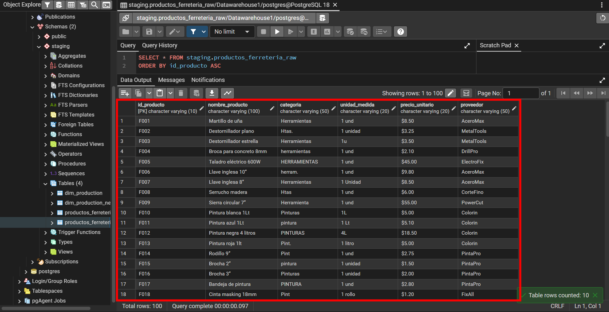
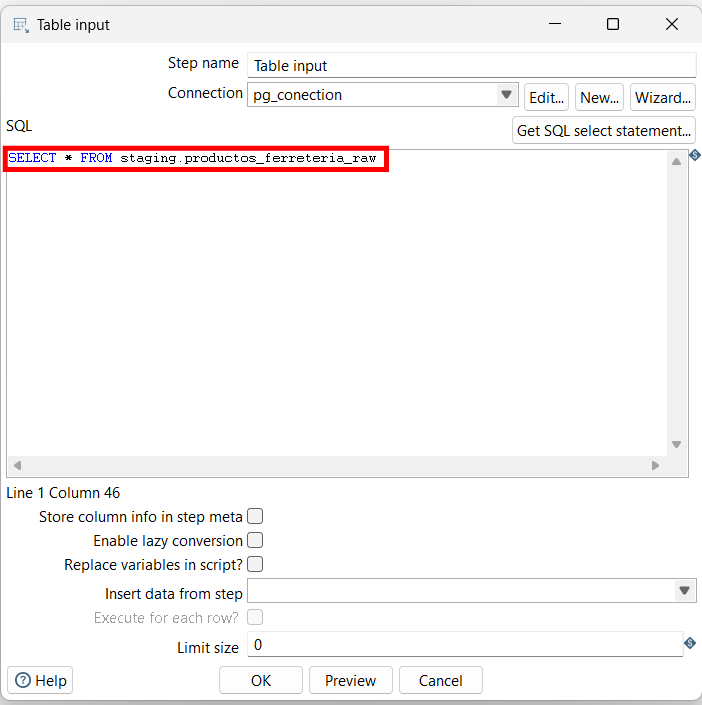
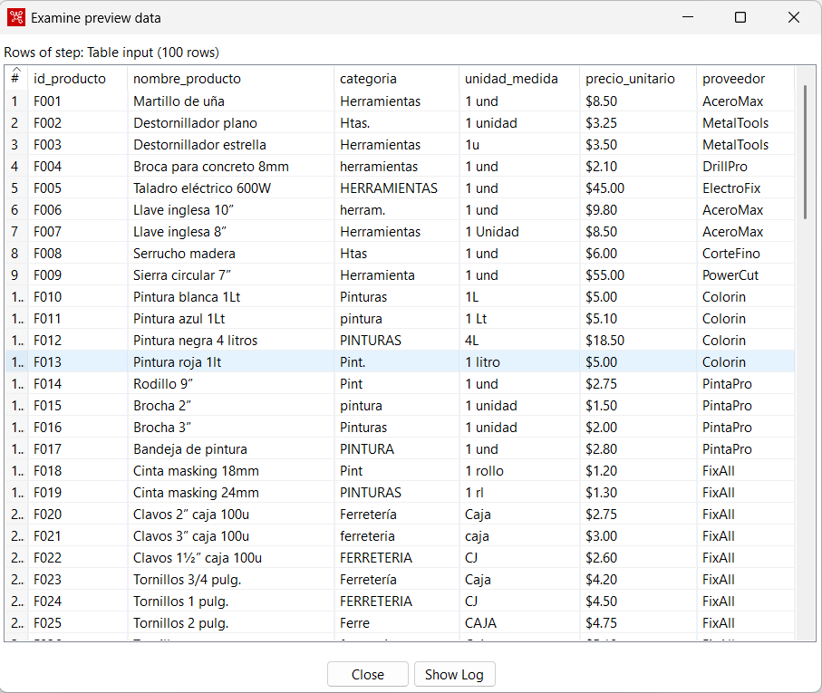
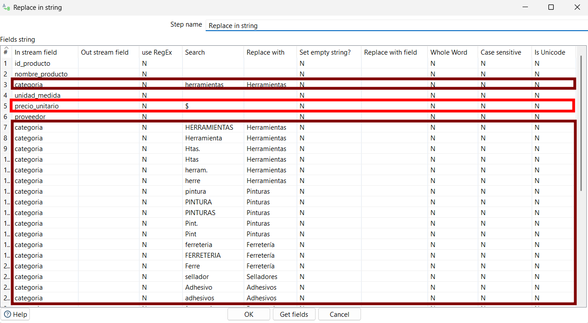
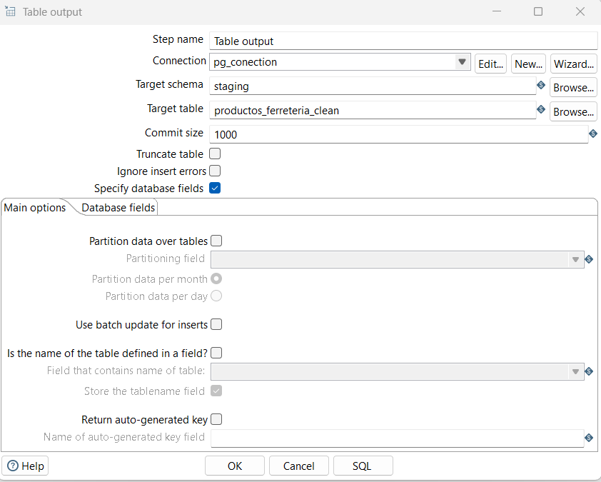
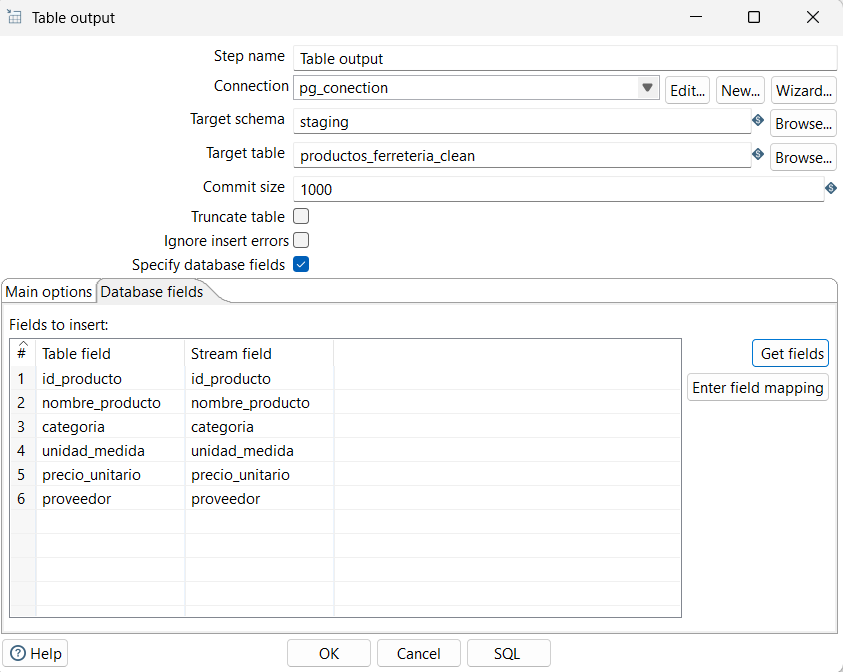
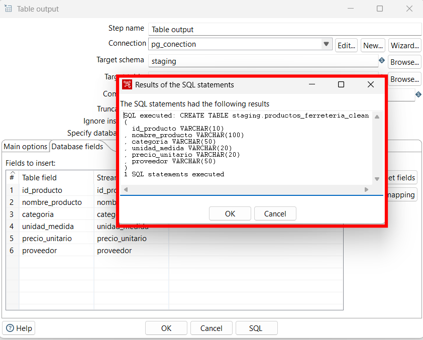
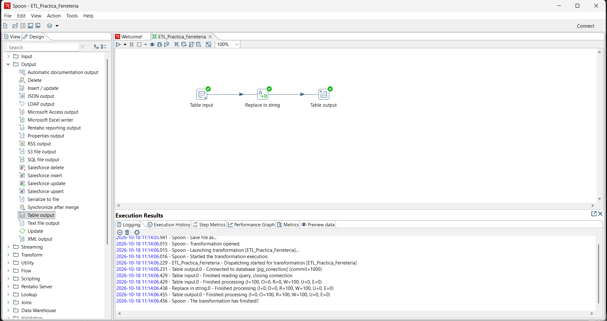
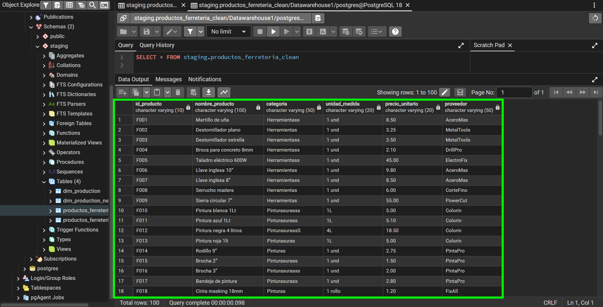

# ESCUELA POLITÉCNICA NACIONAL
### Facultad de Ingeniería de Sistemas

**Asignatura:** Business Intelligence | **Paralelo:** GR2SW | **Integrantes:** Chanatasig Garzón Juan Francisco, Chimarro Bermeo Marlon Xavier, Dávalos Cedeño Martín Alejandro, De La Cruz Cañar Kevin Santiago | **Fecha:** martes 20 de octubre, 2026

---


**Trabajo grupal** · Ferretería El Tornillo Feliz

El proceso implementado extrae 100 productos de PostgreSQL, aplica reglas de limpieza en Pentaho Data Integration y carga los registros en una tabla de destino. El informe presenta la configuración de los pasos y los resultados observados en las capturas.

## Índice

- [1 Objetivo y alcance](#1-objetivo-y-alcance)
- [2 Entorno y datos de origen](#2-entorno-y-datos-de-origen)
- [3 Extracción y diagnóstico de calidad](#3-extracción-y-diagnóstico-de-calidad)
- [4 Transformaciones aplicadas](#4-transformaciones-aplicadas)
- [5 Configuración de la carga](#5-configuración-de-la-carga)
- [6 Flujo ETL desarrollado](#6-flujo-etl-desarrollado)
- [7 Resultados obtenidos](#7-resultados-obtenidos)
- [8 Conclusiones y relación con Business Intelligence](#8-conclusiones-y-relación-con-business-intelligence)
- [9 Referencias bibliográficas](#9-referencias-bibliográficas)
- [10 Declaración del uso de inteligencia artificial](#10-declaración-del-uso-de-inteligencia-artificial)

## 1 Objetivo y alcance

Implementar una carga inicial del catálogo de la Ferretería El Tornillo Feliz desde staging.productos_ferreteria_raw hacia staging.productos_ferreteria_clean. Se busca unificar categorías, retirar el símbolo monetario y estandarizar unidades de medida, conservando la identidad de cada producto.

El caso académico simula registros de distintas sucursales, pero el flujo mostrado utiliza una sola tabla PostgreSQL. No incorpora varias conexiones ni un identificador de sucursal. La limpieza de valores no equivale por sí misma a una normalización relacional ni a la construcción completa de un Data Warehouse.

## 2 Entorno y datos de origen

Se utiliza Spoon de Pentaho Data Integration para diseñar la transformación y pgAdmin para consultar PostgreSQL 18. Las capturas identifican la base Datawarehouse1, el esquema staging y la conexión pg_conection. El archivo de transformación se denomina ETL_Practica_Ferreteria.

### Estructura y preparación de la fuente

La Tabla 1 resume los seis campos definidos en el enunciado [1]. El identificador es clave primaria en la tabla raw. El precio se recibe como texto para conservar el símbolo monetario original.

**Tabla 1. Estructura de la tabla de origen**

| Campo | Tipo SQL | Función |
| --- | --- | --- |
| id_producto | VARCHAR(10) · PK | Identificador F001 a F100 |
| nombre_producto | VARCHAR(100) | Descripción del producto |
| categoria | VARCHAR(50) | Familia comercial |
| unidad_medida | VARCHAR(20) | Presentación o unidad de venta |
| precio_unitario | VARCHAR(20) | Precio original con símbolo $ |
| proveedor | VARCHAR(50) | Nombre del proveedor |

Para preparar el origen, se crea el esquema y la tabla con el siguiente DDL y se ejecuta el bloque INSERT de 100 productos del enunciado [1]. La Figura 1 permite comprobar que la tabla contiene 100 filas y que conserva las variantes originales.

```sql
CREATE SCHEMA IF NOT EXISTS staging;
CREATE TABLE staging.productos_ferreteria_raw (
  id_producto VARCHAR(10) PRIMARY KEY,
  nombre_producto VARCHAR(100), categoria VARCHAR(50),
  unidad_medida VARCHAR(20), precio_unitario VARCHAR(20),
  proveedor VARCHAR(50)
);
```



*Figura 1. Tabla raw y consulta de los productos originales*

## 3 Extracción y diagnóstico de calidad

Table input ejecuta SELECT * FROM staging.productos_ferreteria_raw mediante pg_conection. La Figura 2 muestra la consulta configurada; la Figura 3 presenta la vista previa de 100 registros antes de la limpieza.



*Figura 2. Consulta de extracción en Table input*



*Figura 3. Vista previa de los datos sin transformar*

Se observan categorías con mayúsculas y abreviaturas, como Htas. y HERRAMIENTAS; unidades como 1 unidad, 1u y 1 Lt; y precios como $8.50. El enunciado también contiene espacios finales, por ejemplo en Herramientas para F003.

## 4 Transformaciones aplicadas

Replace in string aplica búsquedas y sustituciones sobre categoria, unidad_medida y precio_unitario. La Figura 4 muestra la configuración del componente. La Tabla 2 detalla las 37 reglas utilizadas para retirar el símbolo monetario y homologar categorías y unidades de medida.



*Figura 4. Reglas iniciales de reemplazo en Spoon*

Las opciones useRegEx, Case sensitive y Whole Word se encuentran en N. Por tanto, la búsqueda literal no distingue mayúsculas y permite coincidencias parciales. La documentación del componente explica estas opciones [2].

La eliminación de $ deja una representación textual del precio. No cambia automáticamente el tipo de dato. La captura de creación de la tabla de destino conserva precio_unitario como VARCHAR(20).

**Tabla 2. Reglas originales de búsqueda y reemplazo**

| In stream field | Search | Replace with | RegEx | Case sens. | Whole Word |
| --- | --- | --- | --- | --- | --- |
| precio_unitario | $ | (vacío) | N | N | N |
| categoria | herramientas | Herramientas | N | N | N |
| categoria | HERRAMIENTAS | Herramientas | N | N | N |
| categoria | Herramienta | Herramientas | N | N | N |
| categoria | Htas. | Herramientas | N | N | N |
| categoria | Htas | Herramientas | N | N | N |
| categoria | herram. | Herramientas | N | N | N |
| categoria | herre | Herramientas | N | N | N |
| categoria | pintura | Pinturas | N | N | N |
| categoria | PINTURA | Pinturas | N | N | N |
| categoria | PINTURAS | Pinturas | N | N | N |
| categoria | Pint. | Pinturas | N | N | N |
| categoria | Pint | Pinturas | N | N | N |
| categoria | ferreteria | Ferretería | N | N | N |
| categoria | FERRETERIA | Ferretería | N | N | N |
| categoria | Ferre | Ferretería | N | N | N |
| categoria | sellador | Selladores | N | N | N |
| categoria | Adhesivo | Adhesivos | N | N | N |
| categoria | adhesivos | Adhesivos | N | N | N |
| categoria | fontaneria | Fontanería | N | N | N |
| categoria | FONTANERIA | Fontanería | N | N | N |
| categoria | seguridad | Seguridad | N | N | N |
| categoria | SEGURIDAD | Seguridad | N | N | N |
| categoria | electricidad | Electricidad | N | N | N |
| categoria | ELECTRICIDAD | Electricidad | N | N | N |
| categoria | Electric. | Electricidad | N | N | N |
| categoria | electr. | Electricidad | N | N | N |
| unidad_medida | 1 unidad | 1 und | N | N | N |
| unidad_medida | 1 Unidad | 1 und | N | N | N |
| unidad_medida | 1u | 1 und | N | N | N |
| unidad_medida | 1 Lt | 1L | N | N | N |
| unidad_medida | 1 litro | 1L | N | N | N |
| unidad_medida | 1 rl | 1 rollo | N | N | N |
| unidad_medida | CJ | Caja | N | N | N |
| unidad_medida | CAJA | Caja | N | N | N |
| unidad_medida | 1 mt | 1 metro | N | N | N |
| unidad_medida | 1 m | 1 metro | N | N | N |

Nota. (vacío) significa dejar Replace with sin texto; no escribir los paréntesis. N equivale a No. La regla herre se conserva por fidelidad a la configuración proporcionada, aunque no aparece como categoría en los 100 registros del enunciado.

## 5 Configuración de la carga

Table output utiliza la misma conexión y escribe en staging.productos_ferreteria_clean. Como muestra la Figura 5, el tamaño de commit es 1000 y Truncate table está desactivado. La Figura 6 documenta la correspondencia directa de los seis campos del flujo con las columnas de destino.



*Figura 5. Opciones de Table output para la tabla clean*



*Figura 6. Mapeo de los campos de entrada y destino*

### Creación de la tabla de destino

La opción SQL genera la sentencia CREATE TABLE y Execute la ejecuta. La Figura 7 confirma una sentencia SQL ejecutada. El DDL visible crea los seis campos como VARCHAR; no declara una clave primaria para el destino.



*Figura 7. Confirmación de la creación de productos_ferreteria_clean*

La carga inicial presupone un destino vacío. Volver a ejecutar Table output con la misma configuración puede insertar los mismos productos de nuevo, porque no hay truncado ni clave primaria en el DDL mostrado. Para repetir la práctica se debe preparar explícitamente el destino y controlar los identificadores duplicados, preservando siempre la tabla raw.

## 6 Flujo ETL desarrollado

El flujo observado está compuesto por Table input, Replace in string y Table output, conectados en ese orden. La extracción obtiene los registros desde PostgreSQL; la transformación modifica cadenas; y la carga persiste las filas en una nueva tabla. La Figura 8 presenta el diagrama y el registro de ejecución.



*Figura 8. Flujo ETL y registro de ejecución finalizada*

La Tabla 3 transcribe los contadores del registro de la Figura 8. I y O corresponden a entrada y salida externas; R y W representan filas leídas y escritas en los flujos; U indica actualizaciones y E errores. El paso de salida informa 100 filas escritas en PostgreSQL.

**Tabla 3. Contadores observados de ejecución**

| Paso | I | O | R | W | U | E |
| --- | --- | --- | --- | --- | --- | --- |
| Table input | 100 | 0 | 0 | 100 | 0 | 0 |
| Replace in string | 0 | 0 | 100 | 100 | 0 | 0 |
| Table output | 0 | 100 | 100 | 100 | 0 | 0 |

La transformación finaliza con 100 registros procesados y E = 0 en los tres pasos, lo que confirma que no se reportaron errores técnicos durante la ejecución.

## 7 Resultados obtenidos

La Figura 9 muestra los 100 registros cargados en staging.productos_ferreteria_clean. En las filas visibles, los precios ya no incluyen el símbolo $ y se observan unidades estandarizadas como 1 und y 1L. La Tabla 4 compara ejemplos del origen con la salida obtenida.



*Figura 9. Consulta de los productos cargados en la tabla clean*

**Tabla 4. Comparación de valores antes y después de la transformación**

| Registro y campo | Valor original | Valor visible en la salida |
| --- | --- | --- |
| F001 · categoria | Herramientas | Herramientass |
| F002 · unidad_medida | 1 unidad | 1 und |
| F010 · categoria | Pinturas | Pinturass |
| F011 · unidad_medida | 1 Lt | 1L |
| F001 · precio_unitario | $8.50 | 8.50 |


## 8 Conclusiones y relación con Business Intelligence

El flujo demuestra la extracción y carga inicial de 100 productos mediante PostgreSQL y Pentaho. La separación entre raw y clean permite conservar los valores originales y repetir la transformación sin perder la trazabilidad del origen.

La práctica permite distinguir las etapas de extracción, transformación y carga, así como comparar los datos originales con la salida para evaluar el efecto de las reglas aplicadas.

En una arquitectura analítica, el esquema staging sirve como espacio intermedio para preparar datos. Un catálogo validado puede alimentar una dimensión Producto; para un Data Warehouse completo todavía serían necesarias decisiones de modelado, claves, historial y tablas de hechos. El ejercicio actual no implementa esos componentes.

## 9 Referencias bibliográficas

Referencias presentadas en formato IEEE. Las capturas corresponden a evidencias del equipo y el conjunto de datos procede de la guía de práctica [1].

[1] Escuela Politécnica Nacional, Facultad de Ingeniería de Sistemas, “2. ETL Initial Load,” guía de práctica de Business Intelligence, s. f., documento de clase facilitado para esta actividad.

[2] Pentaho, “Fields string table,” documentación de Replace in String, versión 10.2. [En línea]. Disponible en: https://docs.pentaho.com/pdia-data-integration/10.2-data-integration/pdi-transformation-steps-reference-overview/replace-in-string/fields-string-table. [Consultado: 18-oct-2026].

## 10 Declaración del uso de inteligencia artificial
Escribir ......
