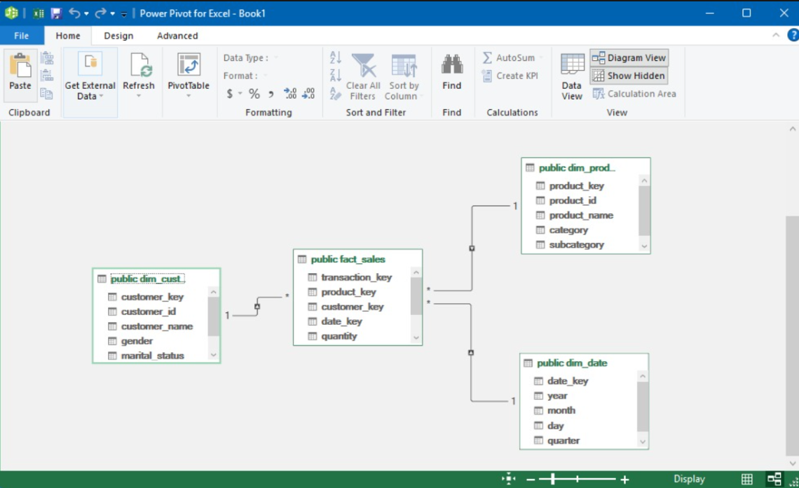

# ESCUELA POLITÉCNICA NACIONAL
### Facultad de Ingeniería de Sistemas

**Asignatura:** Business Intelligence | **Paralelo:** GR2SW | **Integrantes:** Chanatasig Garzón Juan Francisco, Chimarro Bermeo Marlon Xavier, Dávalos Cedeño Martín Alejandro, De La Cruz Cañar Kevin Santiago | **Fecha:** martes 27 de octubre, 2026

---

**Trabajo grupal**: Implementación física de una dimensión para un modelo estrella en PostgreSQL

El presente informe detalla el proceso de diseño, limpieza, carga y consulta de un modelo dimensional tipo estrella utilizando PostgreSQL. A partir de fuentes de datos desnormalizadas, se construyeron dimensiones y una tabla de hechos para analizar las ventas de una organización, culminando con la ejecución de consultas analíticas (OLAP).

## Índice

- [1 Objetivo y alcance](#1-objetivo-y-alcance)
- [2 Entorno y datos de origen](#2-entorno-y-datos-de-origen)
- [3 Modelado Dimensional (Diagrama Power Pivot)](#3-modelado-dimensional-diagrama-power-pivot)
- [4 Configuración de Carga, Validación y Limpieza (ETL)](#4-configuración-de-carga-validación-y-limpieza-etl)
- [5 Creación del Esquema (DDL) y Carga de Datos (DML)](#5-creación-del-esquema-ddl-y-carga-de-datos-dml)
- [6 Consultas de Análisis y Resultados](#6-consultas-de-análisis-y-resultados)
- [7 Conclusiones y relación con Business Intelligence](#7-conclusiones-y-relación-con-business-intelligence)
- [8 Referencias bibliográficas](#8-referencias-bibliográficas)
- [9 Declaración del uso de inteligencia artificial](#9-declaración-del-uso-de-inteligencia-artificial)

## 1 Objetivo y alcance

Implementar un modelo estrella completo en PostgreSQL a partir del dataset `Tabla_Desnormalizada_Ventas.csv` [11] y complementarlo con la carga de la tabla `products.csv` [10]. El alcance abarca desde el diseño del esquema físico (DDL), la extracción, validación y limpieza de los datos hacia tablas de *staging*, hasta la carga final en dimensiones con claves sustitutas (*surrogate keys*) y una tabla de hechos transaccional (DML), finalizando con la validación de los datos mediante consultas de negocio.

## 2 Entorno y datos de origen

El desarrollo se realizó íntegramente utilizando el motor de base de datos relacional PostgreSQL y su interfaz gráfica pgAdmin 4. 

Los datos provienen de dos archivos en formato CSV provistos en la carpeta de entrada del proyecto:
1. [`products.csv`](./Datos%20entrada/products.csv) [10]: Contiene información descriptiva del catálogo de productos (categorías, subcategorías, nombres).
2. [`Tabla_Desnormalizada_Ventas.csv`](./Datos%20entrada/Tabla_Desnormalizada_Ventas.csv) [11]: Contiene el registro transaccional de ventas, incluyendo información del cliente, producto, fechas y métricas (cantidades, ingresos).

Ambos archivos fueron alojados inicialmente en tablas temporales (*staging*) dentro del esquema public de la base de datos para su posterior tratamiento.

## 3 Modelado Dimensional (Diagrama Power Pivot)

Antes de la implementación física en base de datos, se realizó el modelado conceptual y lógico del esquema estrella apoyándonos en Power Pivot. Se identificó el evento de negocio (las ventas) y las entidades descriptivas correspondientes, estableciendo un esquema centralizado.

Como se observa en la **Figura 1**, el modelo consta de una tabla de hechos (`fact_sales`) que almacena las métricas numéricas (cantidad vendida, cantidad enviada), rodeada por sus respectivas dimensiones (`dim_cust`, `dim_prod` y `dim_date`), conectadas a través de relaciones de uno a muchos (1:*) mediante claves sustitutas (*surrogate keys*).

*Figura 1. Diagrama del modelo estrella diseñado en Power Pivot, mostrando la tabla de hechos `fact_sales` conectada a las dimensiones `dim_cust`, `dim_prod` y `dim_date`.*

* **Entregable Power Pivot:** El libro de Excel con el modelo de datos y las relaciones configuradas se encuentra en: [practica4_postgres_db.xlsx](./Datos%20Salida/practica4_postgres_db.xlsx)

## 4 Configuración de Carga, Validación y Limpieza (ETL)

Para garantizar la calidad de la información antes de poblar el modelo estrella, se documentó el proceso de importación y limpieza de las fuentes.

### 4.1 Importación a Staging
El archivo `products.csv` fue cargado en la tabla `stg_products`. Para esta configuración de carga, se utilizó la herramienta *Import/Export Data* de pgAdmin, especificando el formato CSV, codificación UTF-8, y habilitando la opción Header para reconocer los encabezados de las columnas, tal como se documenta en el script [`01_practica_individual_dim_product.sql`](./Datos%20Salida/01_practica_individual_dim_product.sql). Se aplicó un proceso similar para los datos de ventas mediante la sentencia `\copy` registrada en [`03_dml_ventas.sql`](./Datos%20Salida/03_dml_ventas.sql).

### 4.2 Consultas de Validación y Limpieza
Una vez en *staging*, se ejecutaron consultas de validación para verificar el número total de registros, identificar identificadores únicos y asegurar la ausencia de valores nulos o duplicados en las claves primarias naturales (`product_id`), según se detalla en [`01_practica_individual_dim_product.sql`](./Datos%20Salida/01_practica_individual_dim_product.sql).

La limpieza de los datos se realizó mediante sentencias `UPDATE`, estandarizando los textos y eliminando tabulaciones o espacios repetidos utilizando las funciones `btrim()` y `regexp_replace()` nativas de PostgreSQL, como se evidencia en los bloques de limpieza de [`01_practica_individual_dim_product.sql`](./Datos%20Salida/01_practica_individual_dim_product.sql) y [`03_dml_ventas.sql`](./Datos%20Salida/03_dml_ventas.sql).

## 5 Creación del Esquema (DDL) y Carga de Datos (DML)

El proceso de construcción del Data Warehouse local se dividió en scripts entregables que garantizan la reproducibilidad del ejercicio.

### 5.1 Creación de Tablas (DDL)
Se definieron las estructuras físicas asegurando la integridad referencial. Para las dimensiones `dim_ventas_product`, `dim_ventas_customer` y `dim_ventas_date`, y para la tabla de hechos `fact_sales` (esta última con `BIGSERIAL` como *surrogate key*), las claves naturales de los sistemas fuente se mantuvieron como atributos y se configuraron las claves foráneas (`REFERENCES`) e índices correspondientes, tal como se define íntegramente en [`02_ddl_ventas.sql`](./Datos%20Salida/02_ddl_ventas.sql). De forma análoga, la dimensión `dim_product` con su campo `BIGSERIAL` se declara en [`01_practica_individual_dim_product.sql`](./Datos%20Salida/01_practica_individual_dim_product.sql).

* **Entregable DDL:** El script con la creación de la estructura del modelo se encuentra en: [02_ddl_ventas.sql](./Datos%20Salida/02_ddl_ventas.sql)

### 5.2 Carga de Datos (DML)
Tras la limpieza en *staging*, se ejecutaron sentencias `INSERT INTO ... SELECT DISTINCT` para poblar las dimensiones de fecha, producto y cliente asegurando la unicidad de los registros. Finalmente, la tabla de hechos `fact_sales` se pobló a partir de `stg_ventas` tomando directamente las claves ya presentes en el dataset de origen, de acuerdo con el flujo documentado en [`03_dml_ventas.sql`](./Datos%20Salida/03_dml_ventas.sql). El proceso equivalente para la carga individual de `dim_product` se encuentra en [`01_practica_individual_dim_product.sql`](./Datos%20Salida/01_practica_individual_dim_product.sql).

* **Entregable DML (Carga de productos individual):** [01_practica_individual_dim_product.sql](./Datos%20Salida/01_practica_individual_dim_product.sql)
* **Entregable DML (Carga de ventas):** [03_dml_ventas.sql](./Datos%20Salida/03_dml_ventas.sql)

## 6 Consultas de Análisis y Resultados

Para validar la correcta implementación del modelo estrella, se ejecutaron 5 consultas analíticas que responden a requerimientos de negocio específicos utilizando cláusulas `JOIN` entre la tabla de hechos y sus dimensiones, y funciones de agregación (`SUM`, `COUNT`), tal como se detalla en [`04_consultas_entregables.sql`](./Datos%20Salida/04_consultas_entregables.sql).

* **Entregable SQL Consultas:** El script completo con las 5 sentencias se encuentra en: [04_consultas_entregables.sql](./Datos%20Salida/04_consultas_entregables.sql)

A continuación, se presentan las capturas de los resultados obtenidos en pgAdmin:

### 6.1 ¿Cuántas ventas se realizaron por categoría de producto y mes?
La consulta agrupa el conteo de transacciones uniendo la dimensión de productos (para obtener la categoría) y la dimensión de tiempo (para obtener el mes), según la **Consulta 1** de [`04_consultas_entregables.sql`](./Datos%20Salida/04_consultas_entregables.sql). Tal como se detalla en la **Figura 2**, se agrupan los totales permitiendo ver la tendencia mensual por categoría.

.jpeg)
*Figura 2. Resultado de la ejecución en pgAdmin para Ventas por categoría y mes.*

### 6.2 ¿Cuál es el ingreso total (ventas) por cliente y género?
Se suma el monto total de ventas agrupado por el identificador de cliente y su respectivo género, extrayendo los descriptores de `dim_ventas_customer`, conforme a la **Consulta 2** de [`04_consultas_entregables.sql`](./Datos%20Salida/04_consultas_entregables.sql). La **Figura 3** muestra el listado ordenado descendentemente por el ingreso total generado.

*Figura 3. Resultado de la ejecución en pgAdmin para Ingresos por cliente y género.*

### 6.3 ¿Cuál es la cantidad total vendida por producto?
Se utiliza una agregación sobre la métrica de cantidad en la tabla de hechos, agrupada por el nombre y categoría del producto proveniente de `dim_ventas_product`, de acuerdo con la **Consulta 3** de [`04_consultas_entregables.sql`](./Datos%20Salida/04_consultas_entregables.sql). Los resultados de esta métrica se evidencian en la **Figura 4**.

*Figura 4. Resultado de la ejecución en pgAdmin para Cantidad vendida por producto.*

### 6.4 ¿Cuál fue la cantidad enviada por mes de envío?
Para esta consulta se evalúa la dimensión de tiempo asociada específicamente a la fecha de envío (`ship_date_key`), sumando las cantidades enviadas en la tabla de hechos, según la **Consulta 4** de [`04_consultas_entregables.sql`](./Datos%20Salida/04_consultas_entregables.sql). El comportamiento mensual de los envíos se ilustra en la **Figura 5**.

.jpeg)
*Figura 5. Resultado de la ejecución en pgAdmin para Cantidad por mes de envío.*

### 6.5 ¿Cuánto se vendió por tamaño de producto y por estado civil del cliente?
Esta consulta cruzada involucra la tabla de hechos unida simultáneamente a `dim_ventas_product` (para el tamaño) y `dim_ventas_customer` (para el estado civil), sumando los ingresos, tal como se define en la **Consulta 5** de [`04_consultas_entregables.sql`](./Datos%20Salida/04_consultas_entregables.sql). La **Figura 6** presenta el cruce de estas dos variables demográficas y de producto.

.jpeg)
*Figura 6. Resultado de la ejecución en pgAdmin para Ventas por tamaño y estado civil.*

## 7 Conclusiones y relación con Business Intelligence

Se muestra exitosamente cómo pasar de un modelo de datos desnormalizado u orientado a transacciones (archivos planos), a un repositorio preparado para el análisis (Data Warehouse local) utilizando herramientas nativas SQL en PostgreSQL. 

La implementación de claves sustitutas (`BIGSERIAL`) comprobó ser fundamental en el modelo dimensional para aislar al Data Warehouse de los cambios en los sistemas transaccionales fuente. La correcta configuración de carga en las tablas de *staging* y las validaciones posteriores garantizaron la calidad de los datos analizados.

Las consultas finales reafirman el propósito principal del modelado estrella en Inteligencia de Negocios: simplificar y acelerar las consultas analíticas. Al evitar los múltiples saltos requeridos en bases de datos normalizadas, las agregaciones de métricas se resolvieron con comandos `JOIN` directos y eficientes, entregando respuestas claras a las preguntas de negocio.

## 8 Referencias bibliográficas

[1] The PostgreSQL Global Development Group, “PostgreSQL Documentation,” *PostgreSQL*. [En línea]. Disponible en: [https://www.postgresql.org/docs/](https://www.postgresql.org/docs/)

[2] The PostgreSQL Global Development Group, “String Functions and Operators (btrim, regexp_replace),” *PostgreSQL Documentation*. [En línea]. Disponible en: [https://www.postgresql.org/docs/current/functions-string.html](https://www.postgresql.org/docs/current/functions-string.html)

[3] pgAdmin Development Team, “pgAdmin 4 Documentation — Import/Export Data,” *pgAdmin*. [En línea]. Disponible en: [https://www.pgadmin.org/docs/](https://www.pgadmin.org/docs/)

[4] Microsoft, “Introducción a Power Pivot en Microsoft Excel,” *Soporte de Microsoft*. [En línea]. Disponible en: [https://support.microsoft.com/es-es/office/introducci%C3%B3n-a-power-pivot-en-microsoft-excel-ab9bcd20-8d70-4f7f-b033-25c4120bc714](https://support.microsoft.com/es-es/office/introducci%C3%B3n-a-power-pivot-en-microsoft-excel-ab9bcd20-8d70-4f7f-b033-25c4120bc714)

[5] R. Kimball y M. Ross, *The Data Warehouse Toolkit: The Definitive Guide to Dimensional Modeling*, 3.ª ed. Indianapolis, IN, EE. UU.: Wiley, 2013. [En línea]. Disponible en: [https://www.kimballgroup.com/data-warehouse-business-intelligence-resources/kimball-techniques/dimensional-modeling-techniques/](https://www.kimballgroup.com/data-warehouse-business-intelligence-resources/kimball-techniques/dimensional-modeling-techniques/)

[6] Grupo de trabajo, “01_practica_individual_dim_product.sql — Script DDL/DML de la dimensión `dim_product` (staging, limpieza y carga),” Entregable de la Práctica 4, 2026. [En línea]. Disponible en: [./Datos Salida/01_practica_individual_dim_product.sql](./Datos%20Salida/01_practica_individual_dim_product.sql)

[7] Grupo de trabajo, “02_ddl_ventas.sql — Script DDL del modelo estrella de ventas (staging, dimensiones y tabla de hechos),” Entregable de la Práctica 4, 2026. [En línea]. Disponible en: [./Datos Salida/02_ddl_ventas.sql](./Datos%20Salida/02_ddl_ventas.sql)

[8] Grupo de trabajo, “03_dml_ventas.sql — Script DML de carga, limpieza y poblado del esquema estrella de ventas,” Entregable de la Práctica 4, 2026. [En línea]. Disponible en: [./Datos Salida/03_dml_ventas.sql](./Datos%20Salida/03_dml_ventas.sql)

[9] Grupo de trabajo, “04_consultas_entregables.sql — Script con las 5 consultas analíticas entregables sobre el modelo estrella,” Entregable de la Práctica 4, 2026. [En línea]. Disponible en: [./Datos Salida/04_consultas_entregables.sql](./Datos%20Salida/04_consultas_entregables.sql)

[10] Grupo de trabajo, “products.csv — Catálogo de productos (699 registros, 10 categorías, 53 subcategorías),” Dato de entrada de la Práctica 4, 2026. [En línea]. Disponible en: [./Datos entrada/products.csv](./Datos%20entrada/products.csv)

[11] Grupo de trabajo, “Tabla_Desnormalizada_Ventas.csv — Registro transaccional desnormalizado de ventas (cliente, producto, fechas y métricas),” Dato de entrada de la Práctica 4, 2026. [En línea]. Disponible en: [./Datos entrada/Tabla_Desnormalizada_Ventas.csv](./Datos%20entrada/Tabla_Desnormalizada_Ventas.csv)

## 9 Declaración del uso de inteligencia artificial

Para la elaboración de este informe se utilizaron herramientas de Inteligencia Artificial en un porcentaje estimado del 25%, exclusivamente como asistencia para la estructuración en formato Markdown, revisión contra la rúbrica de calificación, ortografía y estilo. Todo el modelado lógico, la creación de los scripts DDL/DML, la ejecución de sentencias en PostgreSQL y el análisis técnico de los resultados presentados son de total autoría de los integrantes del grupo, garantizando la integridad académica del trabajo.