# ESCUELA POLITÉCNICA NACIONAL

### Facultad de Ingeniería de Sistemas

**Asignatura:** Business Intelligence | **Paralelo:** GR2SW | **Integrantes:** Chanatasig Garzón Juan Francisco, Chimarro Bermeo Marlon Xavier, Dávalos Cedeño Martín Alejandro, De La Cruz Cañar Kevin Santiago | **Fecha:** martes 27 de octubre, 2026

---

**Trabajo grupal**: Implementación física de una dimensión para un modelo estrella en PostgreSQL

El presente informe detalla el proceso de diseño, limpieza, carga y consulta de un modelo dimensional tipo estrella utilizando PostgreSQL. A partir de fuentes de datos desnormalizadas, se construyeron dimensiones y una tabla de hechos para analizar la desnutrición infantil en Ecuador, culminando con la ejecución de consultas analíticas (OLAP).

## Índice

- [1 Objetivo y alcance](#1-objetivo-y-alcance)

- [2 Entorno y datos de origen](#2-entorno-y-datos-de-origen)

- [3 Creación del Esquema (DDL)](#3-creación-del-esquema-ddl)

- [4 Configuración de Carga, Validación y Limpieza (ETL)](#4-configuración-de-carga-validación-y-limpieza-etl)

- [5 Consultas de Análisis y Resultados](#5-consultas-de-análisis-y-resultados)

- [6 Modelado Dimensional (Diagrama Power Pivot)](#6-modelado-dimensional-diagrama-power-pivot)

- [7 Conclusiones y relación con Business Intelligence](#7-conclusiones-y-relación-con-business-intelligence)

- [8 Referencias bibliográficas](#8-referencias-bibliográficas)

- [9 Declaración del uso de inteligencia artificial](#9-declaración-del-uso-de-inteligencia-artificial)

## 1 Objetivo y alcance

Implementar un modelo estrella completo en PostgreSQL a partir del dataset `desnutricion_infantil.csv`. El alcance abarca desde el diseño del esquema físico (DDL), la extracción, validación y limpieza de los datos hacia tablas de **staging** mediante Pentaho Data Integration, hasta la carga final en dimensiones con claves sustitutas (**surrogate keys**) y una tabla de hechos transaccional (DML), finalizando con la validación de los datos mediante consultas de negocio y un modelo en Power Pivot.

## 2 Entorno y datos de origen

El desarrollo se realizó íntegramente utilizando el motor de base de datos relacional PostgreSQL y su interfaz gráfica pgAdmin 4. La herramienta ETL utilizada fue Pentaho Data Integration (Spoon).

Los datos provienen de un archivo en formato CSV provisto en la carpeta de entrada del proyecto:

1. `desnutricion_infantil.csv`: Contiene 500 registros con información de niños menores de 5 años, incluyendo identificadores, género, edad en meses, peso, altura, estado nutricional, región e institución de atención.

## 3 Creación del Esquema (DDL)

Se definieron las estructuras físicas asegurando la integridad referencial. Para las dimensiones, se utilizaron campos `SERIAL PRIMARY KEY` para generar las **surrogate keys** automáticamente. La tabla de hechos se configuró recibiendo las claves foráneas de las dimensiones correspondientes.

Las tablas creadas en el esquema `public` de la base de datos fueron:

*   `raw_desnutricion`: Tabla de **staging** (child_id, gender, age_months, weight_kg, height_cm, nutritional_status, region, institution, date_measured).

*   `dim_paciente`: Dimensión de paciente (paciente_key, child_id, gender, age_months).

*   `dim_lugar`: Dimensión de lugar (lugar_key, region, institution).

*   `dim_diagnostico`: Dimensión de diagnóstico (diagnostico_key, nutritional_status).

*   `dim_tiempo`: Dimensión de tiempo (date_key, year, month, day, quarter).

*   `fact_desnutricion`: Tabla de hechos (fact_key, paciente_key, lugar_key, diagnostico_key, date_key, weight_kg, height_cm, casos).

## 4 Configuración de Carga, Validación y Limpieza (ETL)

Para garantizar la calidad de la información antes de poblar el modelo estrella, se documentó el proceso de importación y limpieza de las fuentes mediante transformaciones y un Job en Pentaho.

### 4.1 Carga a Staging (`Load_Staging_raw.ktr`)

Para importar los datos crudos a la tabla temporal, se diseñó un flujo directo que **utiliza únicamente dos componentes**:

1.  **CSV File Input**: Encargado de leer el archivo `desnutricion_infantil.csv`.

2.  **Table Output**: Configurado para insertar los 500 registros directamente en la tabla `raw_desnutricion` de PostgreSQL.

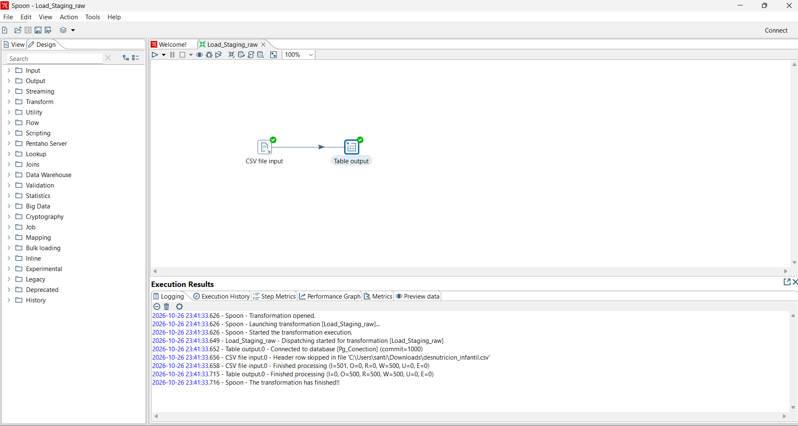

*Figura 1. Carga directa a Staging empleando solo dos componentes.*

### 4.2 Carga de Dimensiones

Se crearon transformaciones individuales para extraer los valores únicos de la tabla de staging y poblar las dimensiones.

*   `load_dim_paciente.ktr`: Selecciona datos únicos de los pacientes.

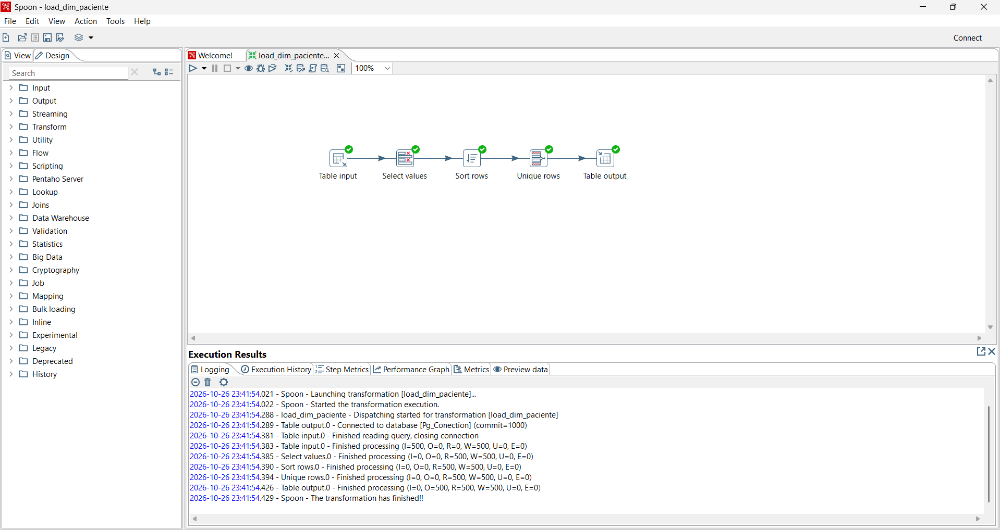

*Figura 2. Transformación para la dimensión paciente.*

*   `load_dim_lugar.ktr`: Identifica combinaciones únicas de región e institución.

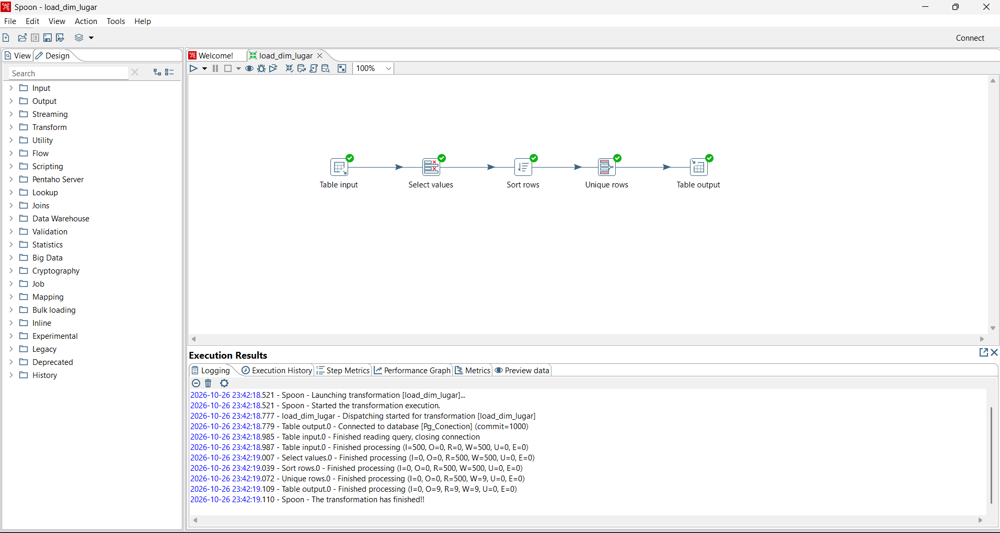

*Figura 3. Transformación para la dimensión lugar.*

*   `load_dim_diagnostico.ktr`: Extrae los estados nutricionales únicos.

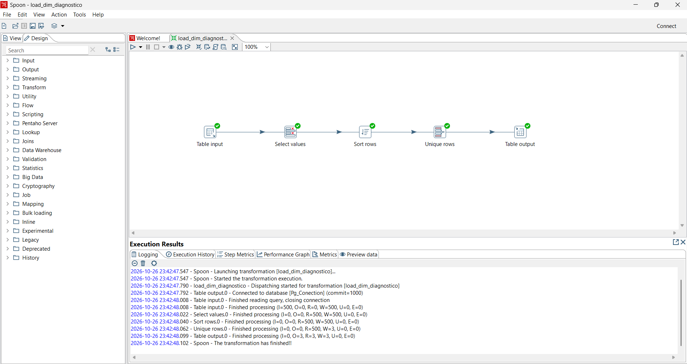

*Figura 4. Transformación para la dimensión diagnóstico.*

*   `load_dim_tiempo.ktr`: Genera las jerarquías de tiempo (año, mes, día, trimestre) a partir de las fechas.

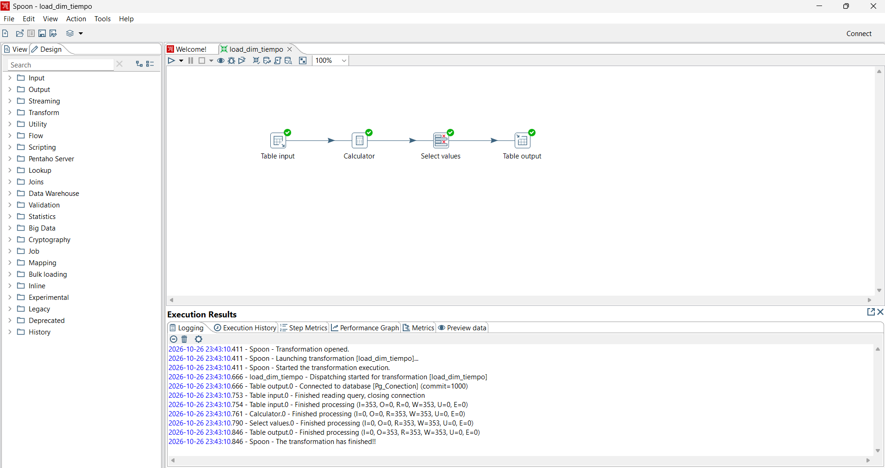

*Figura 5. Transformación para la dimensión tiempo.*

### 4.3 Carga de la Tabla de Hechos (`load_fact_desnutricion.ktr`)

La tabla de hechos se pobló cruzando la tabla de staging con las dimensiones ya creadas para obtener las claves sustitutas correspondientes, utilizando componentes Stream Lookup.

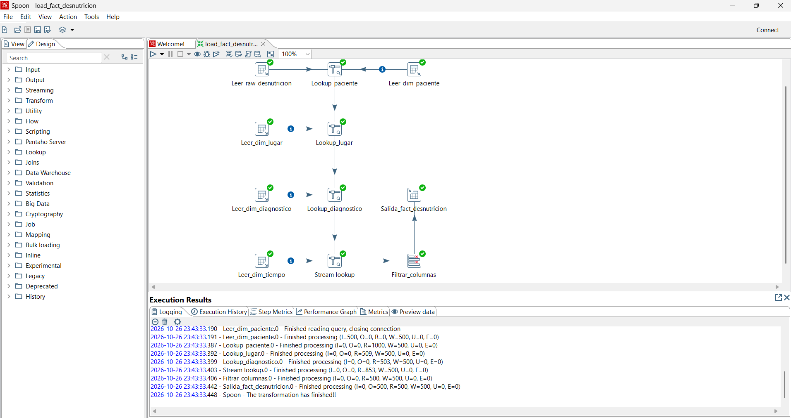

*Figura 6. Transformación para la tabla de hechos con Stream Lookups.*

### 4.4 Ejecución del Job (`etl_job_desnutricion.kjb`)

Se orquestó la ejecución secuencial de todas las transformaciones, iniciando por el staging y finalizando con la tabla de hechos.

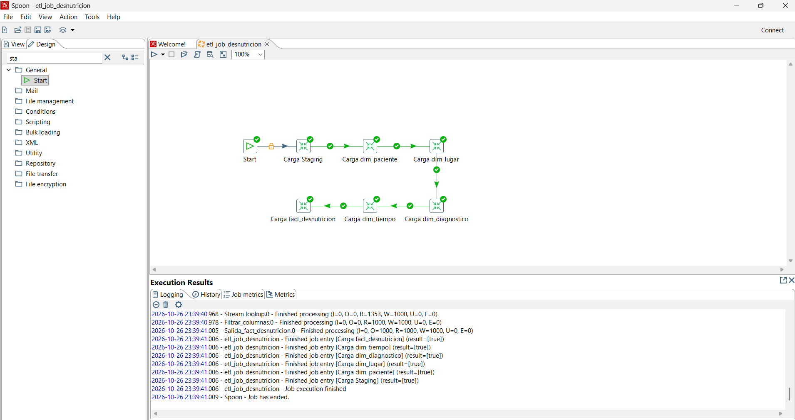

*Figura 7. Ejecución exitosa del Job completo en Pentaho.*

## 5 Consultas de Análisis y Resultados

Para validar la correcta implementación del modelo estrella, se ejecutaron consultas analíticas en PostgreSQL que responden a requerimientos de negocio específicos utilizando cláusulas `JOIN` entre la tabla de hechos y sus dimensiones, y funciones de agregación (`COUNT`).

### 5.1 ¿Cuál es el tipo de desnutrición más común por región?

Mediante un cruce entre la tabla de hechos, la dimensión lugar y diagnóstico, se contabilizaron los casos por región y estado nutricional. En la Amazonía predomina la desnutrición Crónica (57 casos), mientras que en la Costa y la Sierra el diagnóstico más frecuente es Global (69 y 59 casos respectivamente).

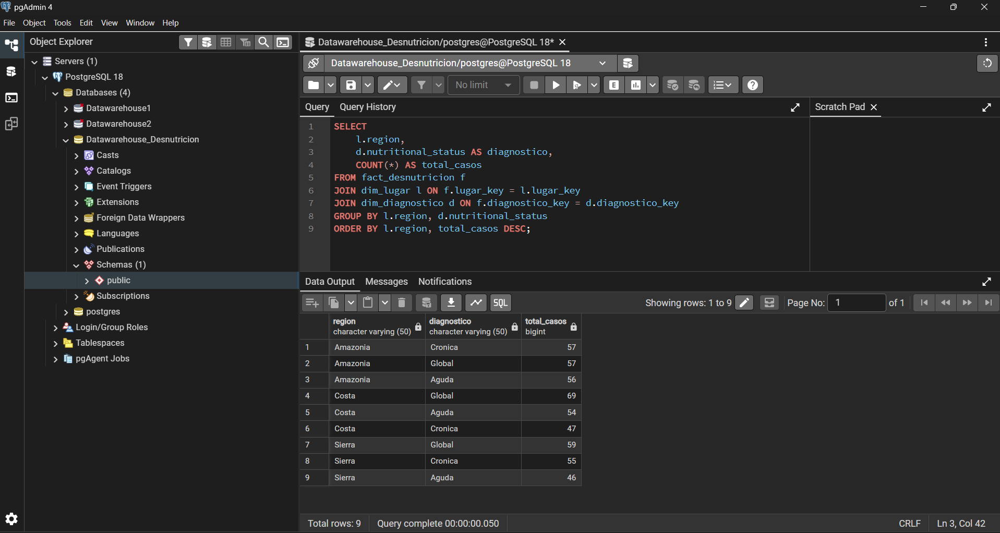

*Figura 8. Resultado de la ejecución en pgAdmin para Desnutrición por región.*

### 5.2 ¿Cómo varía la desnutrición por edad y género?

Al evaluar la tabla de hechos junto a las dimensiones de paciente y diagnóstico, se determinó que la desnutrición "Global" es la más frecuente en general para ambos géneros (92 casos en niñas y 93 en niños). Las niñas presentan una concentración en el rango de mayor edad (49 a 60 meses), mientras que los niños tienen picos en edades intermedias (25 a 48 meses).

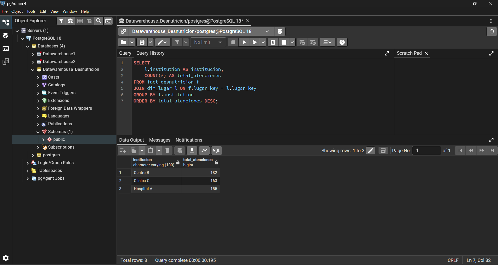

*Figura 9. Resultado de la ejecución en pgAdmin para Desnutrición por edad y género.*

### 5.3 ¿Qué instituciones atienden más casos?

La consulta agrupa el total de atenciones por nombre de institución, revelando que el Centro B posee la mayor carga (182 casos), seguido de la Clínica C (163 casos) y el Hospital A (155 casos).

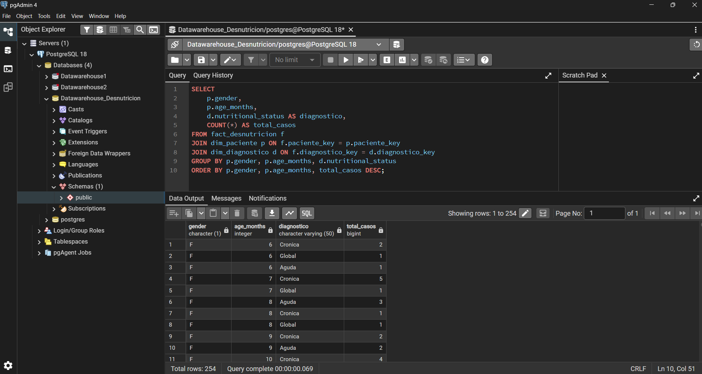

*Figura 10. Resultado de la ejecución en pgAdmin para Instituciones con más atenciones.*

## 6 Modelado Dimensional (Diagrama Power Pivot)

Tras cargar los datos en PostgreSQL, se estableció una conexión ODBC (`Conexion_BI` hacia `localhost` usando el driver psqlODBC y las credenciales del usuario `postgres`) desde Microsoft Excel. Se importaron las 5 tablas al Modelo de Datos usando Power Query y se configuraron las relaciones en la Vista de Diagrama de Power Pivot.

Como se observa en la **Figura 11**, el modelo final consta de una tabla de hechos (`fact_desnutricion`) que almacena las métricas numéricas, conectada a sus respectivas dimensiones a través de relaciones de uno a muchos mediante las claves sustitutas.

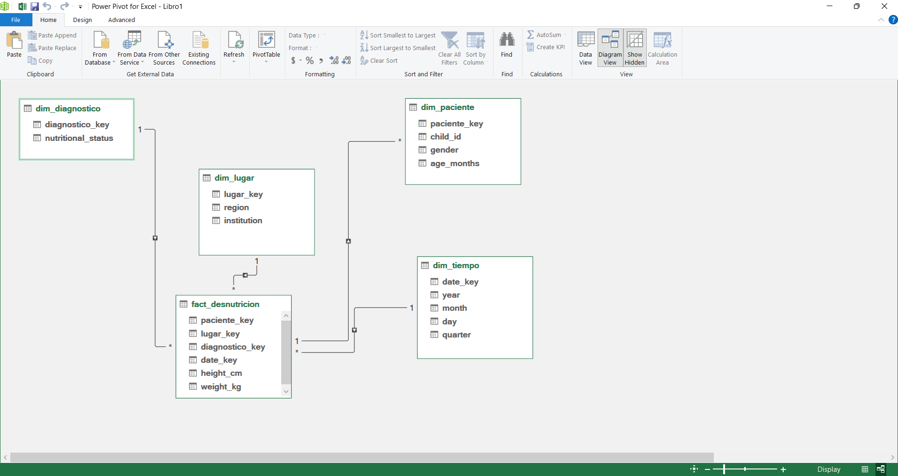

*Figura 11. Diagrama del modelo estrella diseñado en Power Pivot.*

## 7 Conclusiones y relación con Business Intelligence

Se demuestra exitosamente cómo pasar de un modelo de datos desnormalizado u orientado a transacciones (archivos planos), a un repositorio preparado para el análisis (Data Warehouse local) utilizando herramientas ETL (Pentaho) y motores relacionales (PostgreSQL).

La implementación de claves sustitutas (`SERIAL PRIMARY KEY`) comprobó ser fundamental en el modelo dimensional para aislar al Data Warehouse de los cambios en los sistemas transaccionales fuente. La correcta configuración de carga en las tablas de staging y las validaciones posteriores garantizaron la calidad de los datos analizados.

Las consultas finales reafirman el propósito principal del modelado estrella en Inteligencia de Negocios: simplificar y acelerar las consultas analíticas. Al evitar los múltiples saltos requeridos en bases de datos normalizadas, las agregaciones de métricas se resolvieron con comandos `JOIN` directos y eficientes, entregando respuestas claras a las preguntas de negocio, permitiendo que herramientas de visualización como Excel (Power Pivot) consuman el modelo de forma óptima.

## 8 Referencias bibliográficas

[1] Escuela Politécnica Nacional, Facultad de Ingeniería de Sistemas, "Business Intelligence," guía de práctica, 2026.

[2] Kimball, R., y Ross, M., *The Data Warehouse Toolkit: The Definitive Guide to Dimensional Modeling*, 3.ª ed., Wiley, 2013.

[3] PostgreSQL Global Development Group, "PostgreSQL Documentation: Data Definition," *PostgreSQL Documentation*. [En línea]. Disponible en: https://www.postgresql.org/docs/current/ddl.html. [Consulta: 30-oct-2026].

[4] Hitachi Vantara, "Pentaho Data Integration," *Pentaho Documentation*. [En línea]. Disponible en: https://docs.pentaho.com/pdia/data-integration. [Consulta: 30-oct-2026].

[5] Microsoft, "Power Query documentation," *Microsoft Learn*. [En línea]. Disponible en: https://learn.microsoft.com/en-us/power-query/. [Consulta: 30-oct-2026].

[6] Microsoft, "Understand star schema and the importance for Power BI," *Microsoft Learn*. [En línea]. Disponible en: https://learn.microsoft.com/en-us/power-bi/guidance/star-schema. [Consulta: 30-oct-2026].

## 9 Declaración del uso de inteligencia artificial

Para la elaboración de este informe se utilizaron herramientas de Inteligencia Artificial en un porcentaje estimado del 30%, exclusivamente como asistencia para la estructuración en formato Markdown, revisión contra la rúbrica de calificación, ortografía y estilo. Todo el modelado lógico, la creación de los scripts DDL/DML, la ejecución de sentencias en PostgreSQL, la configuración del ETL en Pentaho y el análisis técnico de los resultados presentados son de total autoría de los integrantes del grupo, garantizando la integridad académica del trabajo.