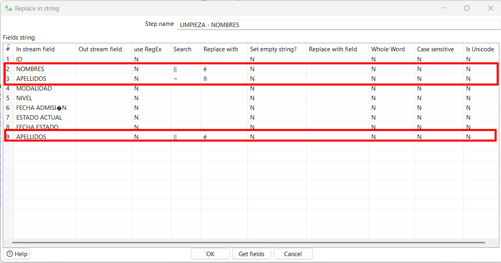
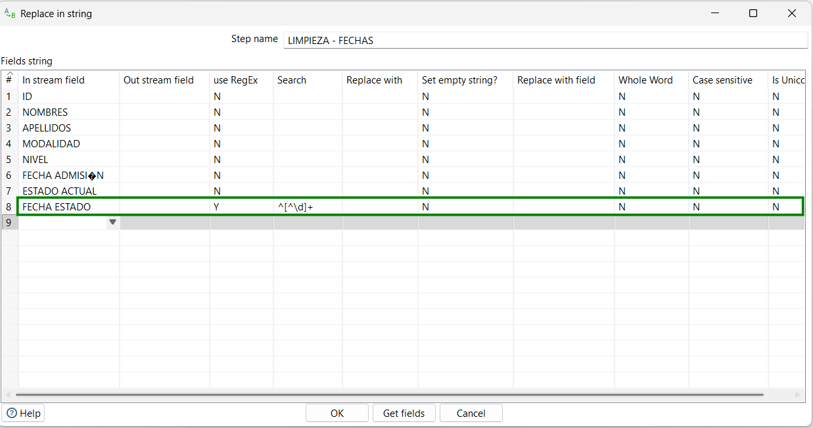
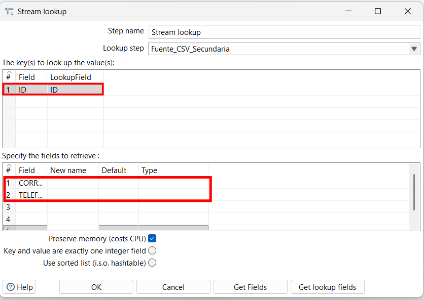
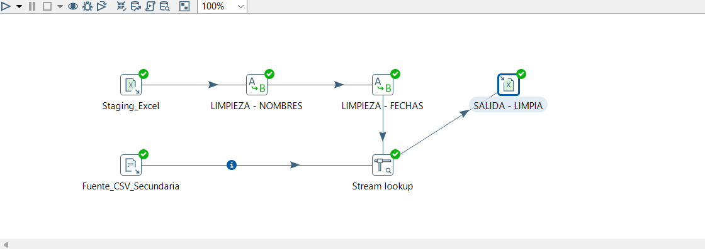
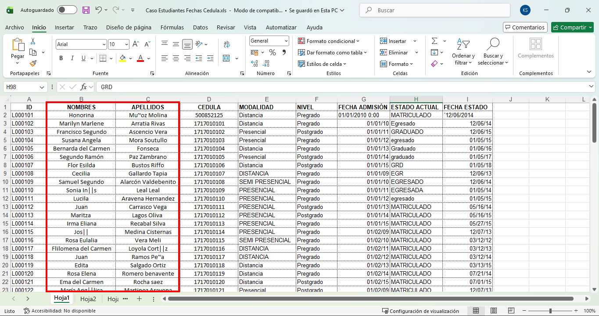
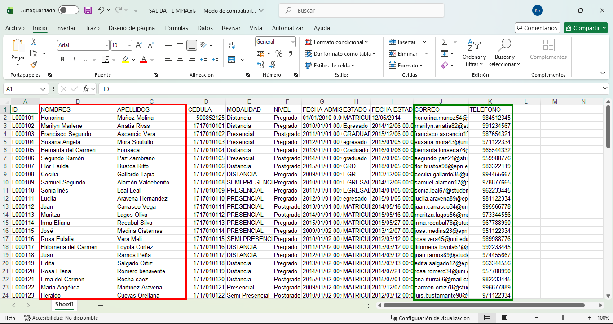

# ESCUELA POLITÉCNICA NACIONAL
### Facultad de Ingeniería de Sistemas

**Asignatura:** Business Intelligence | **Paralelo:** GR2SW |
**Integrantes:** Chanatasig Garzon Juan Francisco, Chimarro Bermeo Marlon Xavier, Dávalos Cedeño Martín Alejandro, De La Cruz Cañar Kevin Santiago |
**Fecha:** martes 13 de octubre, 2026

## 1. Objetivo del proceso
Implementar un flujo ETL (Extract, Transform, Load) y un área temporal de ensayo (*Staging Area*) utilizando Pentaho Data Integration. Con el propósito es extraer, limpiar y estandarizar la información de los estudiantes proveniente de múltiples orígenes, asegurando la calidad y consistencia de los datos para su posterior integración en una solución de Business Intelligence.

## 2. Fuentes de datos utilizadas
Para cumplir con la integración de múltiples orígenes heterogéneos, se utilizaron dos tipos diferentes de fuentes de datos:
- **Fuente 1 (Archivo Principal - Excel):** Archivo `Caso Estudiantes Fechas Cedula.xls` que contiene los registros operacionales originales de los alumnos (IDs, nombres, apellidos, cédulas, modalidad, nivel, fechas de admisión y estados).
- **Fuente 2 (Archivo Secundario - CSV):** Archivo `estudiantes_contacto.csv` que proporciona información complementaria de contacto (correos electrónicos y teléfonos asociados a cada identificador).

## 3. Problemas encontrados en los datos
Durante la etapa de análisis y extracción se detectaron las siguientes inconsistencias:
- **Errores de codificación:** Presencia de símbolos como `~`  o `||` en lugar de tildes y eñes en los campos de texto correspondientes a nombres y apellidos.
- **Espacios excedentes:** Cadenas de texto con espacios en blanco innecesarios al inicio o al final.
- **Anomalías en fechas:** Presencia de caracteres extraños o apóstrofes al inicio de los valores en la columna de fecha de estado.

## 4. Transformaciones aplicadas
Para dar solución a los problemas de calidad identificados, se configuraron las siguientes etapas en el flujo:
- **Limpieza de Nombres y Apellidos:** Uso de un paso *Replace in string* para buscar y reemplazar los caracteres corruptos (`~` por `ñ`, `||` por vocales acentuadas) y estandarizar los campos textuales.

*
<b>Figura 1.</b> Limpieza de errores identificados en los campos de NOMBRE y APELLIDO.
*

- **Validación y Limpieza de Fechas:** Uso de un segundo paso secuencial *Replace in string* empleando expresiones regulares (`^[^\d]+`) para eliminar de forma automática los caracteres inválidos iniciales.

*
<b>Figura 2.</b> Limpieza de errores identificados en el campo FECHA ESTADO.
*

- **Combinación de Fuentes (Stream lookup):** Empleo de este componente para actuar como mecanismo de búsqueda en flujo, utilizando el campo `ID` como llave relacional para recuperar y adjuntar dinámicamente los campos de correo y teléfono al conjunto de datos principal.

*
<b>Figura 3.</b> Configuracion para recuparar campos usando ID del estudiante.
*

## 5. Flujo ETL desarrollado
En la **Figura 3** (del diagrama completo) se detalla el proceso ETL implementado en la interfaz gráfica de Pentaho Data Integration (Spoon). Se observa claramente la extracción desde las dos fuentes (Excel y CSV), las dos transformaciones secuenciales de limpieza, la unión mediante *Stream lookup* y la carga hacia el archivo final.

*
<b>Figura 4.</b> Diagrama completo del flujo ETL implementado en Pentaho Data Integration.
*

## 6. Evidencia del resultado
Tras la ejecución exitosa del flujo sin errores (marcando `E=0` en las métricas del sistema), se generó el archivo de salida procesado. Como se evidencia en la **Figura 6**, los datos finales presentan una correcta depuración de caracteres y la integración exitosa de los campos de contacto multiorigen.

*
<b>Figura 5.</b> Archivo de salida Excel antes de realizar la limpieza.
*

*
<b>Figura 6.</b> Archivo de salida Excel mostrando los datos consolidados y estandarizados.
*

## 7. Relación con una arquitectura de Data Warehouse
En el contexto de Business Intelligence, el proceso ETL junto con el *Staging Area* constituye la columna vertebral que garantiza la integridad de la información:
1. **Desacoplamiento y Persistencia (Staging Area):** Sirve como espacio intermedio que aísla los sistemas de origen. Refleja una copia exacta de las fuentes para que las fases de transformación se ejecuten sin comprometer el rendimiento de los sistemas transaccionales (OLTP).
2. **Data Cleansing:** Las transformaciones ejecutadas garantizan la consistencia semántica y sintáctica, así como la correcta resolución de entidades (cruce de fuentes).
3. **Integración Dimensional:** Estas labores de limpieza son el paso previo e indispensable para alimentar correctamente las **Tablas de Dimensiones** (como la dimensión Estudiante consolidada) y las **Tablas de Hechos** dentro de un modelo dimensional de un Data Warehouse analítico.

## 8. Referencias Bibliográficas
- Inmon, W. H. (2005). *Building the Data Warehouse* (4th ed.). John Wiley & Sons.
- Kimball, R., & Ross, M. (2013). *The Data Warehouse Toolkit: The Definitive Guide to Dimensional Modeling* (3rd ed.). John Wiley & Sons.
- Hitachi Vantara. (2023). *Pentaho Data Integration (Spoon) User Guide*. Documentación oficial de la plataforma.

## 9. Declaración de uso de IA
**Porcentaje de uso de IA declarado:** 15%

**Detalle de uso:** Se utilizó asistencia de Inteligencia Artificial (LLM) de forma complementaria para la revisión ortográfica, gramatical y como medio de consulta, la síntesis de la fundamentación teórica sobre arquitecturas Data Warehouse y la estructuración del formato Markdown de este informe. El diseño técnico, configuración de los bloques, ejecución del flujo en Pentaho y validación de resultados fueron realizados en su totalidad de manera manual e intelectual por los autores del documento.

**Evidencia:** https://share.gemini.google/4nwPu2KJ8DDB
